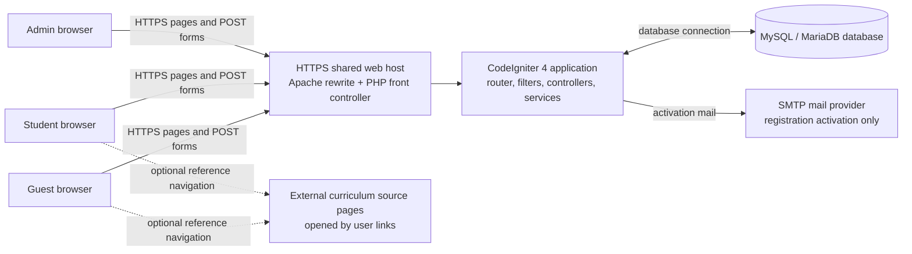
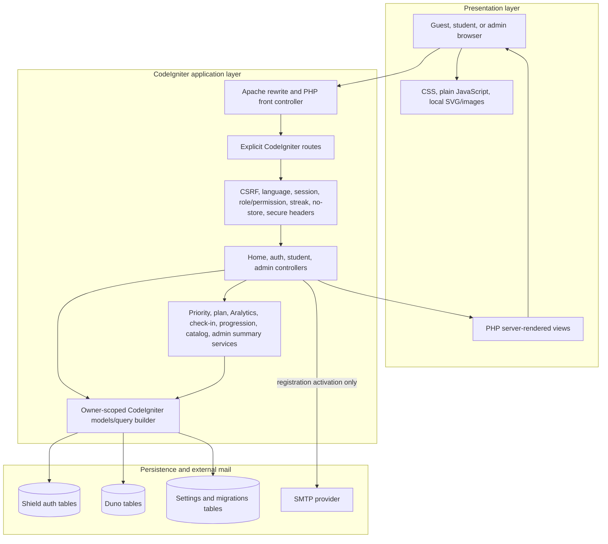
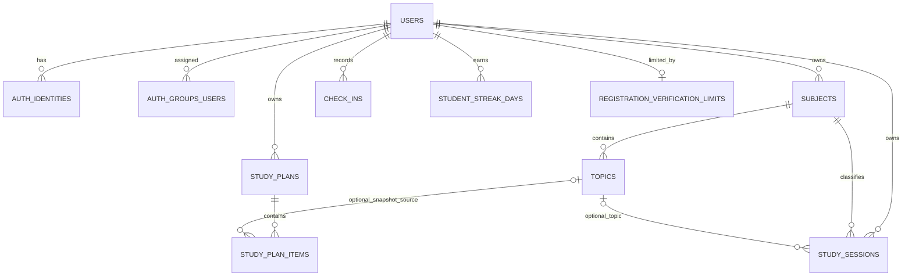

# Duno: System Analysis and Technical Evidence Report

**Academic project title:** Duno: A Personalized Study Planning, Tracking, and Academic Analytics Application 
**Course:** CS PEC 1 - System Development 
**Report date:** 29 October 2026 
**Repository examined:** `main` at `310c5e5` (`Merge InfinityFree .htaccess compatibility fix`), with a non-clean working tree
**Evidence method:** Read-only inspection of source, configuration, migrations, tests, and project records. No test suite, migration, production request, or external service was run or contacted for this report.

> This report describes the repository snapshot, not a guaranteed description of the currently hosted build. Repository and release records disagree about the latest uploaded package. The owner later reported on 2026-10-31 that the live site is available and all pages were checked; this supersedes the earlier provider-403 status below. The latest report does not identify the deployed revision or provide route-by-route evidence, and it was not independently checked here.

## I. Project overview

### Purpose and users

Duno is a browser-based study organization application for individual students. Its documented objective is to help students organize subjects and academic tasks (represented in the app as topics), prioritize unfinished work, create time-limited study plans, record study sessions, and review descriptive activity summaries. Students may also record private workload and energy ratings. Administrators have a restricted aggregate dashboard. The SRS explicitly excludes generative AI recommendations, grade prediction, reminders, calendar integration, group/class accounts, and native applications ([`docs/requirements.md`](requirements.md#L5-L9)).

The project identifies students and administrators as its supported account roles. No survey, interview, usability study, or other user-research dataset was found. Requirements are project-owner-approved/developer-defined requirements; they must not be presented as survey findings ([`docs/requirements.md`](requirements.md#L1-L3), [`docs/development-blueprint.md`](development-blueprint.md#L1-L8)).

### Application type and technology

The application is a server-rendered PHP web application using CodeIgniter 4 MVC, CodeIgniter Shield for authentication and authorization, MySQL/MariaDB, HTML views, CSS, and small plain JavaScript modules. The Composer manifest requires PHP `^8.2`, CodeIgniter Framework `^4.7`, Shield `^1.4`, and PHPUnit `^10.5.16`; the lockfile resolves CodeIgniter 4.7.5, Shield 1.4.1, Settings 2.4.0, and PHPUnit 10.5.x ([`composer.json`](../composer.json), [`composer.lock`](../composer.lock)). Playwright 1.64.1 is a development dependency for Chromium browser checks ([`package.json`](../package.json), [`playwright.config.js`](../playwright.config.js)).

The deployment target recorded in the project is InfinityFree shared hosting. The deployment workflow prepares a local `htdocs`-root package containing application code, vendor dependencies, and public assets for FTP; it does not depend on SSH, server-side Composer, cron, or a frontend build pipeline ([`docs/deployment.md`](deployment.md#L1-L31), [`scripts/Build-InfinityFreePackage.ps1`](../scripts/Build-InfinityFreePackage.ps1)).

### Development and release status

The checked-out branch is `main` at commit `310c5e5`, tracking `origin/main`; the worktree is not clean. Existing local modifications at inspection included `public/index.php`, `docs/deployment.md`, `docs/ai-use-log.md`, `docs/requirements.md`, and a pre-existing draft `docs/system-design-paper-pack.md`. These are not evidence that those changes are committed or hosted. This report is the only new repository file authorized by the brief.

Status labels used in this report:

- **Implemented:** current source contains the feature and the listed path supports it.
- **Partially implemented:** the feature covers a bounded subset of the stated need or does not cover all curricula/contexts implied by its broad name.
- **Unverified:** the repository has code or historical evidence, but this inspection did not execute the check or cannot establish the state of the live host.
- **Not implemented/found:** the inspected repository contains no implementation evidence for the requested capability.

The main student workflows have source implementations (requirements F-01 through F-14), including registration verification, role separation, subjects/topics, priority, planning, timer sessions, Aralytics, check-ins, onboarding, and progression. Their source presence does not establish that the current live release works. Historical test/review records exist, but the latest source changes have not all been covered by those records. The latest live status and exact deployed commit are **not verified from the repository**; deployment documents contain conflicting package markers and the owner reports a host-level 403 (see Sections VIII and VII).

## II. System analysis

### A. Identifying requirements

The principal requirements baseline is [`docs/requirements.md`](requirements.md). It contains functional requirements F-01 through F-14, security requirements S-01 through S-10, owner-confirmed decisions, and acceptance criteria. Feature stories under `docs/` expand acceptance and historical verification details. The repository does not include the original instructor proposal or a separate Phase 2 rubric; project notes state that a live demo is required ([`docs/development-blueprint.md`](development-blueprint.md#L81-L85), [`docs/live-demo-runbook.md`](live-demo-runbook.md)).

The matrix in Section VI maps each FR/S identifier to source, data, tests, and verification limits. Main requirements are represented in the implementation. The most material caveats are scope boundaries and verification, not a demonstrated absence of the core student workflows: the NVSU/CHED/DepEd catalogs are curated reference subsets; no PWA/offline implementation was found; some design stories explicitly await visual review; and current live-host behavior is unavailable for a fresh acceptance check.

### B. Hardware requirements

No minimum client CPU, memory, storage, screen size, server CPU/RAM, or network-bandwidth specification was found in the project requirements or deployment documentation. Do not add numeric hardware minima to the paper without a separate measured or officially specified source.

The repository documents a Windows development setup using XAMPP PHP 8.2.12 and a separate local MariaDB instance; this is a development environment, not a production hardware specification ([`README.md`](../README.md#L23-L29), [`docs/database-setup.md`](database-setup.md)). The intended client is a modern browser on a phone, tablet, or desktop because the requirements call for responsive browser use. This is a supported design target, not a claim that every device/browser has been tested.

The host resources and exact production hardware are provider-managed and **not verified from the repository**. No extra router, local server appliance, or dedicated network equipment is specified. Student and administrator usage requires a client device with a browser and network access to the application. The app does not have a documented offline mode.

### C. Software requirements

| Area | Verified repository evidence | Status / qualification |
|---|---|---|
| Server language/runtime | PHP `^8.2` in Composer; local project notes identify XAMPP PHP 8.2.12. Hosting compatibility is discussed in `docs/development-blueprint.md`. | PHP 8.2+ is a declared development/runtime requirement; exact live PHP version is not currently established. |
| Backend framework | `codeigniter4/framework` `^4.7`, locked to 4.7.5. | Implemented. |
| Authentication/authorization | `codeigniter4/shield` `^1.4`, locked to 1.4.1; custom `Config\AuthGroups`, registration activation action, and role filters. | Implemented; only session authentication is exposed by app routes. |
| Other Composer library | `codeigniter4/settings` 2.4.0 is resolved in the lockfile and provides the settings migration/library. | Framework support dependency; not a primary student feature. |
| Database | CodeIgniter `MySQLi` default, `utf8mb4`; the codebase contains SQLite test configuration patterns. Target is MySQL/MariaDB. | Production migration state cannot be inferred from source alone. |
| Front end | Server-rendered PHP views; local CSS, SVG icons, WebP/PNG images; plain JavaScript modules under `public/assets/js`. | Implemented; no runtime frontend framework/build step declared. |
| Package management | Composer with committed `composer.json` and `composer.lock`; package script uses a locally available Composer PHAR and installed `vendor/`. | Production bundle is prepared locally, then uploaded by FTP. |
| Browser testing | Playwright `@playwright/test` 1.64.1; Chromium configured; one responsive E2E spec is present. | Tests exist. This report did not execute them. |
| PHP testing | PHPUnit `^10.5.16`; `phpunit.dist.xml`; unit and feature test directories. | Tests exist. Historical pass records are not a fresh result for this snapshot. |
| CI | `.github/workflows/ci.yml` runs locked install, Composer validation, PHP syntax checks, PHPUnit, and a locked dependency audit on PHP 8.2/8.4. | Workflow definition exists; the last/current run result is not queried in this read-only audit. |
| PWA/offline | No web app manifest, service worker, Workbox configuration, or offline cache implementation was found in the inspected repository file inventory/search. | Not implemented/found. Do not describe Duno as an installable/offline PWA. |
| Web server/deployment | Apache `.htaccess` rewrite/deny rules and an InfinityFree package builder. | Apache rewrite behavior and host-specific directives require live host verification. |
| SMTP | CodeIgniter Email configuration supports SMTP; deployment docs instruct Gmail SMTP over TLS for registration codes. | Email depends on host/network access to the configured SMTP service. Credentials are held outside source control; values are deliberately not reproduced here. |

The root `env` file is a template, not the private `.env`. Do not include actual SMTP credentials, database credentials, app keys, or local secrets in academic material or screenshots. Runtime settings should be described by variable names and roles only, never values.

### D. User requirements and supported roles

There are two application roles, configured in [`app/Config/AuthGroups.php`](../app/Config/AuthGroups.php):

| Role | Verified capabilities | Explicit boundaries |
|---|---|---|
| Student | Manage own profile username, subjects, topics, priorities, plans, saved sessions, optional check-ins, and view own Aralytics/progression; import available catalog items into own subjects. | Must not access another student's records or the admin route. Email is not an editable profile field in the profile workflow; login identity is managed through Shield. |
| Admin | Open the aggregate dashboard with account, subject, topic, session, and minute totals. | No student record detail, check-in values, exports, or drill-down is in the approved admin scope. Admin routes require the `admin.access` permission. |
| Guest | View the public Duno start page, choose a browser language, register, or sign in. | No student workspace data before authenticated student access. |

Expected flows are documented in `docs/requirements.md` and individual feature stories. They are developer/owner-approved requirements. No survey findings, participant sample, consent protocol, or validated user-needs study was found; **user needs validation via research is not verified from the repository**. The project team should provide actual survey/interview artifacts if the academic chapter claims empirical requirements elicitation.

## III. System design

### A. System components

Routes are explicit; automatic controller routing is disabled. Public routes, Shield auth routes, student routes, and admin routes are declared in [`app/Config/Routes.php`](../app/Config/Routes.php#L6-L67). Server-rendered page/layout components live under `app/Views`; styles and small browser interactions live under `public/assets`.

| Component | Purpose, status, inputs and processing | Outputs and dependencies | Main evidence |
|---|---|---|---|
| Authentication and account management | **Implemented.** Shield registration/login/logout flow; registration uses a numeric email activation action, resend/cancel flows, and per-account verification limits. Inputs include username/email/password/code; Shield and app validation process them. | Session-authenticated user and student group; SMTP activation message; registration/auth notices. Uses `users`, `auth_identities`, auth attempt/token/remember/group/permission tables, and `registration_verification_limits`. | `app/Config/Routes.php` L10-L16; `app/Config/Auth.php`; `app/Authentication/Actions/RegistrationEmailActivator.php`; `app/Controllers/RegistrationRecovery.php`; `app/Models/RegistrationVerificationLimitModel.php`; `tests/feature/AuthenticationFlowTest.php`. |
| Subject and program/catalog management | **Implemented, bounded catalog.** Student enters a title or chooses a listed NVSU program/course, CHED sample, or supported DepEd SHS entry. Imports validate catalog IDs and owner-scope newly created subject rows. | Student's own subject list, optionally tagged with `program_id`; catalog previews and source links. Uses `subjects`; catalog content is static PHP, not relational course tables. | `app/Controllers/Student/Subjects.php`; `app/Services/NvsuProgramCatalog.php`, `NvsuCurriculumCatalog.php`, `ChedCurriculumCatalog.php`, `DepedShsCatalog.php` and import services; `app/Views/student/subjects/*`; `tests/feature/StudentSubjectsTest.php`. |
| Academic task management (topics) | **Implemented.** Topic means a student's task or study item under a subject. Inputs are title, optional due date, importance, and progress. Server validation enforces allowed strings and limits. | Topic lists, detail/edit views, progress state, and owner-scoped topic search results. Uses `topics` under `subjects`. | `app/Controllers/Student/Topics.php`; `app/Models/TopicModel.php`; `app/Views/student/topics/*`; `tests/feature/StudentTopicsTest.php`. |
| Duno Focus | **Implemented as subject/topic management and priority browsing.** Search and filters narrow existing topics; a deterministic score ranks unfinished work. No independent notes database is present. | Ranked topic list with score reasons and links to topic details. Uses `subjects`, `topics`, `TopicPriorityService`. | Routes L22-L38; `app/Services/TopicPriorityService.php`; `app/assets/js/focus-browser.js` (public asset path is `public/assets/js/focus-browser.js`); `tests/unit/TopicPriorityServiceTest.php`. |
| Duno Plan | **Implemented.** Validates available minutes, ranks unfinished topics, builds one 25-minute item per topic until time is exhausted, shortening final item. Users can change progress/duration/order, remove items, add scheduled topic blocks, and navigate dates. | Daily plan and agenda rows; durations are capped by available time; scheduled blocks are checked for conflicts. Uses `study_plans`, `study_plan_items`, `topics`, `subjects`, `TopicPriorityService`, and `DailyPlanService`. | `app/Controllers/Student/Plans.php`; `app/Models/StudyPlanModel.php`, `StudyPlanItemModel.php`; `app/Services/DailyPlanService.php`; `public/assets/js/plan-agenda.js`; `tests/feature/StudentPlansTest.php`. |
| Duno StudyGuide / recommendations | **Partially implemented relative to a broad “study guide” interpretation.** The app has four static, sourced study-suggestion cards on the student dashboard and an onboarding tour through existing tools. No personal recommendation engine, lesson/content library, AI tutor, or separate guide data store was found. | Fixed suggestion content and source links; user-directed help tour. Does not adapt to student profile or claim outcomes. | `app/Content/StudySuggestions.php`; `app/Views/student/dashboard.php`; `app/Views/partials/app_tour.php`; `public/assets/js/onboarding-tour.js`; `tests/unit/StudySuggestionsTest.php`. |
| Study Session Tracker / Duno Timer | **Implemented.** Browser timer supports elapsed/focus presets and pause/review; saving is explicit. Server checks whole-minute duration and that selected subject/topic belong together and to the student. | Saved session row; edit/delete history. Uses `study_sessions`, `subjects`, `topics`; study XP is derived from saved session minutes. | Routes L45-L52; `app/Controllers/Student/StudySessions.php`; `app/Models/StudySessionModel.php`; `public/assets/js/study-sessions.js`; `tests/feature/StudentStudySessionsTest.php`. |
| Aralytics | **Implemented.** Owner-scoped period totals and activity summaries from saved sessions. Check-in pattern counts and rating distributions are separately calculated; printable study report omits check-ins. | Totals, activity series, subject/topic breakdown, unlocks/badges, chart plus numeric equivalent, browser print. Uses sessions, check-ins, streak days and calculation services. | `app/Controllers/Student/Aralytics.php`; `app/Services/AralyticsService.php`, `CheckInSummaryService.php`, `StudyProgressionService.php`; `app/Views/student/aralytics/index.php`; `tests/feature/StudentAralyticsTest.php`. |
| Academic wellness/context check-ins | **Implemented as private workload and energy ratings.** Student supplies two integer ratings (1-5); can edit/delete; records are kept until student deletion. No free-text notes or health assessment. | Private last-seven-day and selected-period counts/distributions. Not used for schedule or XP. Uses `check_ins`. | `app/Controllers/Student/CheckIns.php`; `app/Models/CheckInModel.php`; `app/Views/student/check-ins/*`; `tests/feature/StudentCheckInsTest.php`. |
| Administrator functions | **Implemented as aggregate-only dashboard.** Admin requests summary; service counts students and study data without student-level drill-down. | Aggregate cards; no check-in details. Uses Shield roles and aggregate SQL against `users`, `subjects`, `topics`, `study_sessions`. | `app/Controllers/Admin/Dashboard.php`; `app/Services/AdminDashboardSummaryService.php`; `app/Config/AuthGroups.php`; `tests/feature/AdminDashboardTest.php`. |
| Progressive Web App functionality | **Not implemented/found.** Responsive pages and browser-local preferences do not establish PWA capability. No manifest/service worker/offline installation cache was found. | No verified install prompt, offline content, or background sync. | File inventory/search of `public/`, `app/`, `package.json`; **not verified from repository** beyond these absent artifacts. |

### B. Workflow design

The descriptions below reconstruct flows from explicit routes, controllers/models/services, and corresponding tests. Inputs and failures are representative of implemented validation; they are not claims of live acceptance.

#### 1. Registration, email activation, login and logout

**Actor/trigger:** guest opens registration or sign-in. **Inputs:** username, email, password and confirmation; an activation code for an unverified account. **Processing:** the explicit Shield routes use `auth-rates`; configured auth defaults new public accounts to `student`; the custom registration action sends a numeric activation code through configured email transport. Resend and cancel are POST routes. A model tracks failed attempts and send cooldown/daily caps; Shield activation enforces code validity/expiry according to configured action. **Data:** Shield auth tables and `registration_verification_limits`. **Output:** an activation/login prompt, authenticated session, or an error/redirect. **Evidence:** `app/Config/Routes.php` L10-L16, `app/Config/Auth.php`, `app/Config/AuthGroups.php`, `app/Authentication/Actions/RegistrationEmailActivator.php`, `app/Controllers/RegistrationRecovery.php`, `tests/feature/AuthenticationFlowTest.php`. Exact current SMTP delivery and hosted activation behavior are not verified in this audit.

#### 2. Subject and academic task management

**Actor/trigger:** student opens Focus/Subjects and submits create/edit/delete or topic forms. **Inputs:** subject name and optional program code; topic title, optional due date, importance, and progress. **Processing:** explicit student-role route filter runs; controller validates request and obtains authenticated owner ID; model scopes by owner and parent subject; application validation constrains fields. Catalog imports accept IDs from an in-code catalog and add selected titles as the student's subjects, skipping duplicates according to the import service. **Data:** `subjects`, `topics`, and optional `program_id`. **Output:** updated subject/topic page or field/operation feedback. Deletion is blocked where topic/session references would break retained records. **Evidence:** `app/Config/Routes.php` L18-L37 and L58-L63; `app/Controllers/Student/Subjects.php`, `Topics.php`; `SubjectModel.php`, `TopicModel.php`; `tests/feature/StudentSubjectsTest.php`, `StudentTopicsTest.php`.

#### 3. Priority calculation

**Actor/trigger:** student opens the priority list. **Inputs:** owner-scoped topic records and the application date. **Processing:** exclude completed topics; add importance points (low/medium/high = 1/2/3), due-date points (overdue/today = 3; within seven days = 2; later = 1; no date = 0), and one point for not-started progress; order by score descending, due date, title, and ID; render each component as a reason. **Data:** reads `topics` joined to owned `subjects`; no score is stored. **Output:** ranked list and explanations. **Evidence:** `app/Services/TopicPriorityService.php`; [`docs/priority-story.md`](priority-story.md); `tests/unit/TopicPriorityServiceTest.php`.

#### 4. Plan generation and agenda adjustment

**Actor/trigger:** student submits available study minutes or adjusts a day/topic block. **Inputs:** available minutes (15-480), unfinished topic IDs, optional date/start time/duration/order/progress. **Processing:** derive priority order; allocate 25 minutes per unfinished topic while capacity remains, shortening the final block; model validates ownership, bounds, duplicate topics, schedule overlap and daily cap; writes the plan and items transactionally. Date-based agenda additions require an owned unfinished topic and a valid time/duration. **Data:** `study_plans`, `study_plan_items`, and referenced topics. **Output:** saved plan/agenda and remaining time; invalid or conflicting edits are rejected with feedback. **Evidence:** `app/Services/DailyPlanService.php`; `app/Models/StudyPlanModel.php`; `app/Controllers/Student/Plans.php`; `public/assets/js/plan-agenda.js`; `tests/feature/StudentPlansTest.php`. The nullable start-time migration exists; whether every deployment has it must be checked against that deployment's migration ledger.

#### 5. Timer and saved session

**Actor/trigger:** student chooses an owned subject and optional topic, starts/pauses/stops a timer, then reviews. **Inputs:** subject/topic, elapsed focus time, and explicit save choice. **Processing:** JavaScript maintains the displayed timer; server accepts a whole-minute duration from 1 to 480 only after a save form is submitted; `StudySessionModel` rechecks subject owner and topic-subject relationship; saved rows can be edited or deleted by their owner. Timer interruption does not silently create a row. **Data:** `study_sessions`; optional foreign keys to owned subject/topic. **Output:** review, explicit save/discard, or session history. **Evidence:** `public/assets/js/study-sessions.js`; `app/Controllers/Student/StudySessions.php`; `app/Models/StudySessionModel.php`; `tests/feature/StudentStudySessionsTest.php`.

#### 6. Suggestions, check-ins and Aralytics

Dashboard shows fixed study suggestions from `App\Content\StudySuggestions`. A student can voluntarily submit workload/energy ratings; the controller records application-local time and owner ID, and the model permits owner-scoped list/edit/delete. Aralytics selects today, seven days, 30 days, or all time for study records; its service calculates totals, averages, subject/topic breakdowns and activity series. A separate service summarizes private check-in counts/distributions. Print behavior is a browser print view; check-in patterns are excluded. These are descriptive counts, not medical assessment or inferred state. Evidence: `app/Controllers/Student/Dashboard.php`, `Aralytics.php`, `CheckIns.php`; services named above; `app/Views/student/aralytics/index.php`; `tests/feature/StudentAralyticsTest.php`, `StudentCheckInsTest.php`.

#### 7. Administrator aggregate view

**Actor/trigger:** authenticated admin opens `/admin/`. **Inputs:** none beyond the authenticated account. **Processing:** session, exclusive-role, and `admin.access` permission filters authorize route; service queries aggregate counts and minutes. **Data:** account roles and aggregate domain tables; check-ins are excluded. **Output:** aggregate dashboard. **Evidence:** `app/Config/Routes.php` L66-L67; `app/Config/AuthGroups.php`; `app/Services/AdminDashboardSummaryService.php`; `tests/feature/AdminDashboardTest.php`. No admin CRUD/account management is exposed by the current explicit route map.

### C. Input-Process-Output (IPO) model

| Module | Inputs | Processing verified in source | Outputs | Principal evidence |
|---|---|---|---|---|
| Authentication | Registration fields; activation code; login credentials; resend/cancel action | Shield auth/activation, configured validation and throttling, custom per-account send/attempt limits | Session, activation email, redirect/status feedback | Auth routes/config/action, registration recovery/limit model |
| Subjects/catalog import | Subject name/program ID or selected catalog IDs | Validate title/IDs, verify catalog membership, owner-scope insert, duplicate handling | Student-owned subject records; filtered list | Subjects controller/model and NVSU/CHED/DepEd catalog/import services |
| Topics/Focus | Title, date, importance, progress; search/filter values | Validate fields; scope through owned subject; filter records; score unfinished topics and order | Topic records, filtered list, priority reasons | Topics controller/model; `TopicPriorityService` |
| Plan | Available minutes, date and block changes | Rank topics; allocate 25-minute durations; enforce capacity, owner/reference and schedule-conflict rules | Plan header, ordered/scheduled items, remaining capacity | `DailyPlanService`; `StudyPlanModel` |
| Timer/session history | Subject/topic, elapsed time, explicit save/edit/delete | Browser timer display; server validates duration and ownership relations | Saved session and history row; progression input | Study sessions controller/model/JS |
| Check-ins | Workload and energy integers 1-5 | Owner-scoped validation and time recording; aggregate counts only | Private records and descriptive summaries | CheckIn controller/model; check-in services |
| Aralytics/progression | Saved sessions, selected date period, streak rows | Sum/count/average/group by topic/subject/date; derive XP, streak/level/unlocks and chart series | Dashboard cards, charts/tables, printable session report | Aralytics/progression services and view |
| Admin dashboard | Authenticated admin request | Permission check; aggregate allowed counts | Totals only | Admin route/controller/summary service |

## IV. Network and security considerations

### A. Network requirements and communication paths

The verified request path is browser -> HTTPS web server/front controller -> CodeIgniter router/filters/controllers -> application services/models -> MySQL/MariaDB. PHP-generated HTML returns through the web server; public CSS, JavaScript, SVG and image files are served as static assets. Only registration verification requires outbound SMTP. The catalog source URLs are reference links opened when a user follows a citation; catalog content itself is PHP data and is not fetched from an API on each request ([`app/Services/NvsuCurriculumCatalog.php`](../app/Services/NvsuCurriculumCatalog.php), `ChedCurriculumCatalog.php`, `DepedShsCatalog.php`; [`docs/deployment.md`](deployment.md#L145-L147)).

The application's PHP session uses CodeIgniter's file handler by default, with a configured writable session directory and a 7,200-second expiration ([`app/Config/Session.php`](../app/Config/Session.php)). Database connection values are intended to be environment-configured; `app/Config/Database.php` shows a MySQLi default and `utf8mb4`, while deployment records instruct the owner to use the provider-assigned hostname/port. The database is not contacted directly by a student's browser. The exact production network topology and whether the web and database servers are colocated are **not verified from the repository**.

Most features require a working network connection to the web application and database. Email activation also requires outbound SMTP. Public images/scripts are local project assets, but there is no documented service worker, offline data store, or offline write queue. Therefore no offline capability should be claimed. The project notes that the target host disables remote MySQL access; verify exact provider policy for the current account through supplied deployment evidence, not a diagram assumption ([`docs/development-blueprint.md`](development-blueprint.md#L15-L25)).

### B. Data protection controls and verification limits

| Control area | Repository evidence | Limitation / status |
|---|---|---|
| Passwords and identities | Shield auth routes and models; `Config\Auth` sets a minimum password length of eight and composition/personal-information/dictionary validators. Shield auth migration has an identity secret field and unique identity key. | Duno does not implement its own password storage. Do not describe a custom hashing algorithm; Shield owns credential handling. No credential value is included in this report. |
| Email activation | Custom Shield `EmailActivator` subclass documents a 15-minute code expiry; per-account model limits failed attempts to five and caps sends at five/day with a one-minute cooldown. Auth routes are wrapped in Shield's `auth-rates` filter. | Live SMTP and activation acceptance cannot be freshly checked from the host in this audit. |
| Sessions/cookies | Session driver is `FileHandler`, expiry 7,200 seconds, regeneration interval 300 seconds. Cookie config marks cookies HttpOnly, SameSite=Lax and Secure in production ([`app/Config/Session.php`](../app/Config/Session.php), [`app/Config/Cookie.php`](../app/Config/Cookie.php#L42-L87)). | Effective host cookie behavior requires response inspection. `regenerateDestroy` is false; old session data is left to garbage collection after ID regeneration. |
| Authorization | Explicit routes and global/route filters; student routes require `session` plus `exclusive-role:student`; admin requires session, exclusive admin role, and `admin.access`. Public registration default group is student. | No native database row-level security policies exist. Authorization and row ownership are application-enforced. |
| Ownership and relation validation | Models generally require authenticated owner ID for queries/mutations; topic methods join through owned subjects; session model validates subject and optional topic association. Composite foreign keys additionally enforce study-session owner/subject and topic/subject consistency. | `study_plan_items` foreign keys do not themselves bind the topic to the plan owner's user; application model checks enforce this. Direct database writes bypassing app logic could create a cross-owner plan-item reference. |
| Input validation and SQL access | Framework validation rules in subject/topic models and explicit bounds in session, plan and check-in models; CodeIgniter query builder or bound queries used. | Importance/progress and rating ranges are validated by application logic; the Duno migrations do not define SQL `CHECK` constraints for those values. |
| Output handling | PHP views consistently use CodeIgniter `esc()` for user-provided values in representative views; framework production errors are configured separately. | This report did not perform a complete taint-tracking/security scan over every template. |
| CSRF | `csrf` filter is global before all routes in `app/Config/Filters.php`; mutation routes use POST. CSRF protection configured with session storage in `app/Config/Security.php`. | Host-specific CSRF cookie/session behavior needs a deployed smoke check. |
| Response headers/cache | Global after filters include `no-store-pages` and CodeIgniter `secureheaders`; `NoStorePagesFilter` applies no-store controls to dynamic responses. | Exact live headers are not captured. `app/Config/App.php` has CSP disabled, so a Content Security Policy should not be claimed as currently enforced. |
| Production errors | `app/Config/Database.php` defaults database debug off when `ENVIRONMENT` is production; deployment template sets production mode. | No production error-path test or current host response was run for this report. |
| Private files | Root and generated package `.htaccess` deny private directories, dotfiles, common backup/database extensions, and app/build/docs/tests/vendor/writable paths. The package builder writes its own root routing and deny rules (`scripts/Build-InfinityFreePackage.ps1`). | Historical direct probes were partly owner-reported; `/.env` response had no HTTP status. Current live 403 is host-generated and prevents a fresh Duno-specific path probe. Do not claim every deployed path is currently verified. |
| Sensitive data and logs | `docs/ai-agent-workflow.md`, security story and deployment procedure prohibit real student records/secrets in source/test artifacts; check-in ratings are excluded from admin and printed study report. | No backup/restore runbook or automated encrypted backup mechanism was found. Production backup retention/access controls are **not verified from the repository**. |
| Browser security policy | `SecureHeaders` is enabled and `CSPEnabled` is false. | Baseline headers exist in configuration; actual host header set is unverified. CSP is not active. |

Privacy wording: check-ins contain only workload and energy ratings plus owner/time metadata. The product decision says the student may edit or permanently delete entries, which otherwise remain until deletion. It is not a health assessment. Student ownership is not equivalent to database-native RLS; call it application-enforced row-level access control.

### C. User access and permissions

| Operation | Guest | Student | Admin |
|---|---:|---:|---:|
| View public start page/language selector | Yes | Yes | Yes |
| Register as a student / activate email | Yes | No (already authenticated) | No (already authenticated) |
| View own dashboard, subjects, topics, Focus and priority | No | Yes, own data only | Denied by exclusive-role filter |
| Create/update/delete subjects and topics | No | Yes, owner-scoped; history rules may block deletion | No |
| Import NVSU/CHED/DepEd catalog entries | No | Yes, adds selected course titles to own subjects | No |
| Create/change date-based study plan | No | Yes, own plan/topics only | No |
| Start and save/edit/delete study sessions | No | Yes, own records only | No |
| Create/view/edit/delete workload-energy check-ins | No | Yes, own records only | No |
| View own Aralytics, progression and private check-in summaries | No | Yes | No |
| View aggregate student/system totals | No | No | Yes, via `admin.access` |
| View individual student study/check-in detail | No | No | No route is defined in approved admin surface |

The table reflects explicit routes and approved scope, not a formal third-party authorization audit. `app/Config/Routes.php` disables auto-routing and assigns filters to student/admin route groups. Controller/service behavior and feature tests add owner checks. Direct access control, production role provisioning, and hosted denials are not freshly retested here.

## V. Design documentation

### A. Evidence-based flow descriptions

The seven user flows in Section III.B can be drawn as process flowcharts using the supplied trigger/input/decision/output steps. The decisions to represent explicitly are:

1. **Registration:** valid registration fields? -> create pending student identity -> activation email sent? -> valid, unexpired code and remaining attempts? -> activate and permit login; otherwise show retry/limit/cancel outcome.
2. **Subject/topic:** authenticated student? -> validate submitted fields and catalog IDs -> parent record belongs to owner? -> persist or return validation/ownership failure; deletion checks saved topic/session references.
3. **Priority:** load owned unfinished topics -> compute three score components -> sort deterministically -> display score and reason labels; empty result renders an empty state.
4. **Plan:** minutes in 15-480? -> load owned unfinished topics -> rank -> allocate in 25-minute increments with final shortening -> save/update owner/date plan -> validate add/edit/reorder/remove requests against capacity and schedule overlap.
5. **Timer/session:** choose owned subject and optional topic -> start/pause/stop -> review duration -> explicit save? -> validate (1-480 whole minutes) and relationship -> persist; discard/refresh does not save automatically.
6. **Aralytics/check-in:** choose period -> read owner-scoped saved sessions and check-ins separately -> aggregate each with deterministic services -> display; print excludes check-in patterns.
7. **Admin:** session authenticated? -> admin exclusive role? -> `admin.access`? -> calculate five aggregate totals -> render aggregate dashboard. No data drill-down branch exists.

The full internal flow of Shield's activation-code generation/email composition is in the installed dependency; the application provides its configured action and limits. No separate administrator account-management workflow is implemented in the visible route map.

### B. Network diagram specification

Use the network diagram in Section IV.A. Label the browser-to-app and browser-to-static-assets requests HTTPS. Show the application server connecting to MySQL/MariaDB and, only for activation messages, SMTP. Show external NVSU/CHED/DepEd pages as optional user-followed reference links, not as live app APIs. Do not draw a client-to-database connection, AI provider, CDN, offline sync, or background worker; these were not found in source.

### C. System architecture diagram

This is a logical architecture derived from the configured stack and code paths; it does not state physical server placement. The main separation is server presentation/controllers, deterministic business services, owner-scoped data access, and relational persistence. Controllers often instantiate models/services directly rather than using a separate dependency-injection/application-service layer; the architecture should be described as a pragmatic CI4 MVC design, not as microservices or strict Clean Architecture.

### D. Data-flow diagrams

**Level 0 context diagram entities and flows:**

| External entity | Data sent to Duno | Data received from Duno |
|---|---|---|
| Guest | Registration/login fields, activation code, language preference | Public page/auth form, activation/status messages |
| Student | Subject/topic data, filters, plan choices, timer/session save choice, optional ratings, profile username | Own topics/priority/plan/session history/Aralytics/progression and validation/status feedback |
| Admin | Authenticated request for admin dashboard | Aggregate totals only |
| SMTP provider | N/A | Registration activation message/code delivery request; Duno does not consume a mailbox dataset |
| Curriculum source sites | No automatic app data feed | User follows source links from catalog previews |

**Level 1 processes and data stores:**

1. **P1 Account/session management** reads/writes Shield identities, user/group and auth-attempt/token records; reads/writes registration verification limits; sends activation mail through SMTP.
2. **P2 Subject/catalog management** reads static in-code catalogs; reads/writes `subjects` for the authenticated owner.
3. **P3 Topic and priority management** reads/writes `topics` through owned `subjects`; priority scores are computed in memory, not stored.
4. **P4 Plan management** reads topic/subject data and writes `study_plans` and `study_plan_items` for the authenticated owner.
5. **P5 Session tracking** reads subjects/topics and writes/reads `study_sessions`; study-derived XP and summaries are calculated from the rows.
6. **P6 Check-in and student Aralytics** reads/writes `check_ins`, reads sessions and `student_streak_days`, and returns owner-only descriptive aggregates; does not expose individual check-in values in print/admin.
7. **P7 Admin aggregation** reads account roles and aggregate counts from users/subjects/topics/sessions; returns totals without row-level drill-down.

**Data stores:** Shield user/auth tables; Duno subjects, topics, plans/items, sessions, check-ins, streak days and registration verification limits; CodeIgniter Settings; CodeIgniter migration ledger. Static catalog arrays are application files, not database stores. Avoid showing a separate “program catalog” or “curriculum table” in the DFD.

### E. Database design and inventory

The Duno migrations define eight domain tables. Installed Shield and Settings packages add framework-owned tables; CodeIgniter maintains a migration ledger. The table names below follow their configured defaults in the inspected source. **A source migration is not proof it ran on production.** The owner previously reported 16 rows in the hosted migration ledger, latest batch 11, with `study_plan_items.start_time` present; the source inventory contains twelve app migrations plus one Shield auth migration and one Settings migration. The ledger/source difference must be reconciled before claiming exact production schema parity. Do not run or replay a migration based on this report.

#### Duno-owned tables

| Table / model | Columns and types from migrations | Keys, relationships and purpose |
|---|---|---|
| `subjects` / `SubjectModel` | `id INT(10) UNSIGNED AUTO_INCREMENT`; `user_id INT(10) UNSIGNED`; `name VARCHAR(120)`; later-added nullable `program_id VARCHAR(80)`; nullable `created_at`, `updated_at DATETIME` | PK `id`; index `(user_id,name)`; after session-integrity migration, unique `(user_id,id)` for composite references; FK `user_id -> users.id` CASCADE delete/update. Student-owned subject/course title. Program ID is an application catalog code, not a foreign key. `CreateSubjects.php`; `AddNvsuProgramToSubjects.php`; `EnforceStudySessionReferenceIntegrity.php`. |
| `topics` / `TopicModel` | `id INT(10) UNSIGNED AUTO_INCREMENT`; `subject_id INT(10) UNSIGNED`; `title VARCHAR(120)`; nullable `due_date DATE`; `importance VARCHAR(8) NOT NULL DEFAULT 'medium'`; `progress VARCHAR(12) NOT NULL DEFAULT 'not_started'`; nullable timestamp fields | PK `id`; index `(subject_id,due_date)`; FK `subject_id -> subjects.id` RESTRICT delete/update; after integrity migration, unique `(id,subject_id)` for composite session reference. Represents tasks/study topics under a subject. `CreateTopics.php`; `EnforceStudySessionReferenceIntegrity.php`. |
| `study_plans` / `StudyPlanModel` | `id INT(10) UNSIGNED AUTO_INCREMENT`; `user_id INT(10) UNSIGNED`; `plan_date DATE`; `available_minutes SMALLINT(5) UNSIGNED`; nullable timestamps | PK `id`; unique `(user_id,plan_date)` means one plan per user and app-local date; FK user -> users CASCADE/CASCADE. `CreateDailyPlans.php`. |
| `study_plan_items` / `StudyPlanItemModel` | `id INT(10) UNSIGNED AUTO_INCREMENT`; `plan_id INT(10) UNSIGNED`; nullable `topic_id INT(10) UNSIGNED`; `topic_title VARCHAR(120)`; `subject_name VARCHAR(120)`; `duration_minutes SMALLINT(5) UNSIGNED`; later nullable `start_time TIME`; `position SMALLINT(5) UNSIGNED`; nullable timestamps | PK `id`; indexes `(plan_id,position)` and unique `(plan_id,topic_id)`; FK `plan_id -> study_plans.id` CASCADE/CASCADE; FK topic -> topics uses SET NULL on delete, CASCADE on update. Title/name snapshots retain readable block labels if the topic row is deleted. `CreateDailyPlans.php`; `AddPlanItemStartTimes.php`; `AlignStudyHistoryForeignKeys.php`. |
| `study_sessions` / `StudySessionModel` | `id INT(10) UNSIGNED AUTO_INCREMENT`; `user_id`, `subject_id` INT(10) UNSIGNED; nullable `topic_id INT(10) UNSIGNED`; `duration_minutes SMALLINT(5) UNSIGNED`; `completed_at DATETIME`; nullable timestamps | PK `id`; index `(user_id,completed_at)` and relationship indexes; FK user -> users CASCADE/CASCADE; composite FK `(user_id,subject_id) -> subjects(user_id,id)` RESTRICT/CASCADE; composite FK `(topic_id,subject_id) -> topics(id,subject_id)` RESTRICT/RESTRICT. These preserve user/subject/topic consistency and saved study history. Earlier single-column subject/topic FKs are removed by later migrations. `CreateStudySessions.php`; `AlignStudyHistoryForeignKeys.php`; `EnforceStudySessionReferenceIntegrity.php`. |
| `check_ins` / `CheckInModel` | `id INT(10) UNSIGNED AUTO_INCREMENT`; `user_id INT(10) UNSIGNED`; `workload_rating TINYINT(1) UNSIGNED`; `energy_rating TINYINT(1) UNSIGNED`; `recorded_at DATETIME`; nullable timestamps | PK `id`; index `(user_id,recorded_at)`; FK user -> users CASCADE/CASCADE. The application accepts ratings 1-5; no SQL CHECK constraint is declared. `CreateCheckIns.php`. |
| `student_streak_days` / `StudentStreakModel` | `id INT(10) UNSIGNED AUTO_INCREMENT`; `user_id INT(10) UNSIGNED`; `activity_date DATE`; `streak_days INT(10) UNSIGNED`; `xp_awarded SMALLINT(5) UNSIGNED`; `created_at DATETIME` | PK `id`; unique `(user_id,activity_date)` ensures at most one stored visit reward per student/date; FK user -> users CASCADE/CASCADE. Study-session XP is calculated from session minutes rather than stored here. `CreateStudentStreakDays.php`; `ScaleProgressionXp.php`. |
| `registration_verification_limits` / `RegistrationVerificationLimitModel` | `user_id INT(11) UNSIGNED`; `failed_attempts TINYINT(3) UNSIGNED DEFAULT 0`; nullable `last_sent_at DATETIME`; `sends_today TINYINT(3) UNSIGNED DEFAULT 0`; nullable `send_day DATE`; nullable timestamps | `user_id` is PK and FK -> users.id CASCADE/CASCADE. Stores rate-limit counters, not a separate user profile. `CreateRegistrationVerificationLimits.php`. |

#### Framework-owned tables

| Table | Purpose and major fields from installed package migration | Keys/relationships |
|---|---|---|
| `users` | Shield account record: integer ID, nullable username/status/status message, active flag, last-active and created/updated/deleted timestamps. Email/password identities are stored in `auth_identities`, not as a plain email/password pair in this table. | PK `id`; unique username. |
| `auth_identities` | Login/activation identity: ID, user ID, type/name, secret/secret2, expiry, extra, force-reset flag, last-used and timestamps. | PK `id`; unique `(type,secret)`; FK user with cascade delete. Shield manages credentials and identity semantics. |
| `auth_logins` | Auth attempt audit: ID, IP address, optional user agent, identity type/identifier, optional user ID, timestamp, success flag. | PK `id`; indexes by `(id_type,identifier)` and `user_id`; migration intentionally does not define a user FK so attempt evidence can persist. |
| `auth_token_logins` | Token login attempt fields similar to login attempts. | PK `id`; indexes by `(id_type,identifier)` and `user_id`; no user FK. No token API route is exposed by Duno. |
| `auth_remember_tokens` | Remember-me selector, hashed validator, user ID, expiry and timestamps. | PK `id`; unique selector; FK user with cascade. Shield config disables remembering in the current auth session config. |
| `auth_groups_users` | User/group assignment (`user_id`, `group`, created time). | PK `id`; FK user with cascade; configured groups are student and admin. |
| `auth_permissions_users` | Per-user permission assignments (`user_id`, `permission`, created time). | PK `id`; FK user with cascade. Group-level admin permission is configured in `AuthGroups`. |
| `settings` | CodeIgniter Settings key/value rows: ID, class, key, nullable text value, type, timestamps. | Settings package creates table; exact extra constraints are not relied on by Duno domain logic. |
| `migrations` | CodeIgniter migration ledger stores applied migration version/class/group/namespace/time/batch metadata. | Framework-managed migration bookkeeping; not a Duno business table. Exact production rows require ledger inspection. |

Shield schema evidence is the installed `vendor/codeigniter4/shield/src/Database/Migrations/2020-12-28-223112_create_auth_tables.php`; Settings schema evidence is `vendor/codeigniter4/settings/src/Database/Migrations/2021-07-04-041948_CreateSettingsTable.php`. Package migration names and fields should be version-pinned in the paper because framework upgrades may alter them.

#### Entity relationships

This is a logical ER view. The constraints described in the tables are authoritative where a diagram notation cannot show composite columns or delete/update actions. Catalog programs/campuses/courses and study suggestions are static code; they do not appear as relational entities.

#### Schema design findings and caveats

1. **Study-history integrity is relatively strong.** The later composite keys protect session user-subject and topic-subject consistency at the database layer. This is stronger than relying solely on controller checks.
2. **Plan-item ownership remains application-enforced.** `study_plan_items` has independent FKs to plan and topic, not a composite FK proving that both belong to the same student. `StudyPlanModel` checks the owner on normal app writes, but direct SQL or a future code regression could create a cross-owner reference. A future schema strengthening could add redundant owner ID or composite keys; that is a design recommendation, not current schema.
3. **Some domain constraints live only in PHP.** Importance/progress allowed values, session duration limits, check-in rating range, and plan time/capacity constraints are not fully encoded as SQL CHECK constraints. Database engines may vary in CHECK behavior; acceptance currently depends on server-side application validation.
4. **Catalog persistence is intentionally sparse.** `subjects.program_id` is a nullable string, not a FK. NVSU and curricula are code-defined and versioned with source references; this is suitable for a bounded static catalog but not a relational catalog maintenance system or institution-wide offering inventory.
5. **Snapshot fields trade normalization for history readability.** Plan item topic and subject names can become stale after a rename, but they let past plan blocks remain readable after their optional topic link is cleared.
6. **Migration state requires reconciliation.** Source migrations define schema evolution, but hosted state must be established from an explicit database export/ledger. Owner-reported migration 16 / batch 11 and nullable `start_time` are useful reported evidence, not a complete live schema audit. No migration was applied during this inspection.

### F. Technical specifications

| Specification | Verified detail |
|---|---|
| Application architecture | CodeIgniter 4 MVC with explicit routes, filters, server-rendered PHP views, services for deterministic calculations, models for persistence. Not microservices. |
| PHP/framework versions | PHP requirement `^8.2`; CodeIgniter 4.7.5 and Shield 1.4.1 locked by Composer. Settings 2.4.0. |
| Database driver | MySQLi in app config; MySQL/MariaDB target; UTF-8 MB4 connection charset. Tests have SQLite support where configured. |
| Browser code | Plain JavaScript for timer, tour, agenda, responsive focus, notification behavior, charts/print and preferences; CSS and local static assets. No frontend runtime framework. |
| Environment configuration | `.env` (untracked/private) for base URL, production mode, DB connection and SMTP; `env` is a safe template. Exact secret values are excluded. |
| Development tooling | Windows/XAMPP; local project PHP 8.2.12 per README; Composer PHAR under ignored `.tools`; npm used for Playwright dev dependency. Exact machine hardware is not specified. |
| Test tooling | PHPUnit configuration `phpunit.dist.xml`; Playwright config defaults to Chromium and local `http://localhost:8080/index.php/`, override via `TALAS_BASE_URL`. CI workflow runs PHP 8.2/8.4. |
| Build/deploy | `scripts/Build-InfinityFreePackage.ps1` copies app/assets/front controller, generates an `htdocs` root rewrite/deny `.htaccess`, creates writable directories, copies locked vendor dependencies and runs Composer `--no-dev`; ZIP is uploaded manually by FTP. |
| PWA/build tooling | No manifest, service worker, offline shell, npm production build or bundler was found. |
| Operations | No cron/worker requirement or implementation; daily visit XP is processed on authenticated student requests. No automated DB backup/restore mechanism was found. |
| Hosted constraints | Project design targets free shared hosting with assigned document root and restricted server-side tools as described in deployment notes. Current host-specific PHP/extensions, DB engine version and actual deployed file set are not verified in this report. |

## VI. Requirements traceability matrix

Status describes the current repository implementation. Verification describes recorded evidence, not a new test result from this report.

### Functional requirements

| ID | Requirement summary | Implementation status | Source paths / data | Relevant tests or acceptance record | Verification status and gap |
|---|---|---|---|---|---|
| F-01 | Public start page; student register, numeric email activation, sign in/out; unverified user blocked; recovery/cancel and throttles | Implemented | `Home.php`; `Config/Routes.php`; `Config/Auth.php`; `RegistrationEmailActivator.php`; `RegistrationRecovery.php`; Shield tables; `registration_verification_limits` | `tests/feature/AuthenticationFlowTest.php`; `docs/auth-foundation-story.md` | Historic auth/email hosting flow is owner-reported. No fresh email/host check; live 403 and deployed revision unknown. |
| F-02 | Separate student/admin access; server-side denial by role | Implemented | `Config/Routes.php` student/admin groups; `ExclusiveRoleFilter.php`; `Config/AuthGroups.php` | `AuthenticationFlowTest.php`, `AdminDashboardTest.php`; auth story | Prior role tests and owner-hosted checks recorded; no current host route check. |
| F-03 | Student subject create/read/edit/delete | Implemented | `Student/Subjects.php`; `SubjectModel.php`; `subjects` | `StudentSubjectsTest.php`; subject story | Historical feature tests/owner review recorded; no test rerun for this report. |
| F-04 | Manage topics under subjects with due date, importance, difficulty, progress | Implemented | `Student/Topics.php`; `TopicModel.php`; `topics` | `StudentTopicsTest.php`; topic story | Difficulty is Low/Medium/High, defaults to Medium; hosted migration 000001 was confirmed at batch 12 on 2026-10-31. |
| F-05 | Search/filter owner topics and subjects | Implemented | `TopicModel::searchForOwner`, `SubjectModel::searchForOwner`; POST search/filter routes | `StudentTopicsTest.php`, `StudentSubjectsTest.php`; `search-filter-story.md` | Code and historical tests support it; no new run. Search is POST to keep search text out of URL. |
| F-06 | Explainable, deterministic priority list using deadline, importance, difficulty, and progress | Implemented | `TopicPriorityService::rank`; `topics`, `subjects` | `TopicPriorityServiceTest.php`; `priority-story.md` | Owner-approved formula includes difficulty; Plan consumes the ordering. Ranking is calculated, not stored. |
| F-07 | 15-480 minute daily plan with ordered topic blocks, adjustments and phone agenda | Implemented in source; latest agenda flow unverified | `Plans.php`; `DailyPlanService`; `StudyPlanModel`; `study_plans`, `study_plan_items`, `topics` | `StudentPlansTest.php`; `plan-generation-story.md` | Core plan journey historically owner-reviewed. Agenda tests/browser checks are documented as pending in parts of story; host `start_time` column was owner-confirmed. Reconcile migration ledger before claiming deployed parity. |
| F-08 | Timer, explicit review/save, edit/delete session | Implemented | `StudySessions.php`; `StudySessionModel`; `study-sessions.js`; `study_sessions` | `StudentStudySessionsTest.php`; `study-session-story.md` | Historical feature/host walkthrough recorded; no fresh browser or host review. |
| F-09 | Aralytics for saved study, private separate check-in patterns, print report | Implemented | `Aralytics.php`; `AralyticsService`; `CheckInSummaryService`; `StudyProgressionService`; sessions/check-ins/streak tables | `StudentAralyticsTest.php`; `AralyticsServiceTest.php`; `aralytics-story.md` | Historical service/feature/browser records exist. Current charts and print appearance were not rechecked. |
| F-10 | Curated study suggestions with verified program-outcome associations where available | Implemented in current worktree | `app/Content/StudySuggestions.php`; `app/Content/StudyGuideOutcomes.php`; dashboard view | `StudySuggestionsTest.php`; `StudentDashboardTest.php`; `study-suggestions-story.md` | CHED CMO 25 s. 2015 program outcomes shown for owned NVSU-linked BSCS/BSIS/BSIT subjects. Associations are Duno editorial links; course outcomes and unverified programs remain unmapped. |
| F-11 | Optional private workload/energy ratings and descriptive counts | Implemented | `CheckIns.php`; `CheckInModel`; `CheckInSummaryService`; `check_ins` | `StudentCheckInsTest.php`; `private-check-in-story.md` | Historical privacy tests recorded. Owner-approved policy is retention until student deletion, no automatic expiry. No fresh check. |
| F-12 | Admin aggregate student/subject/topic/session/minute totals | Implemented | `Admin/Dashboard.php`; `AdminDashboardSummaryService`; users/subjects/topics/sessions | `AdminDashboardTest.php`; `admin-dashboard-story.md` | Historical tests and owner-hosted review recorded. Current production role/data results unverified. |
| F-13 | Responsive mobile/desktop, keyboard, print, skippable/replayable guide and contextual navigation | Partially implemented; fresh review pending | responsive layouts, `app_tour.php`, `onboarding-tour.js`, page layouts and navigation JS; browser-only preferences | `tests/e2e/responsive.spec.js`; `responsive-accessibility-story.md`; `student-onboarding-story.md` | Earlier viewport/keyboard checks recorded, but latest UI requests and accumulated CSS/JS changes await a fresh visual check; current host blocks it. |
| F-14 | 100 XP per saved minute, 500 daily visit XP, consecutive-day streak and deterministic unlocks | Implemented | `StudentStreakFilter.php` calls `StudentStreakService::recordVisit()` on authenticated student GET requests; `StudyProgressionService`; `student_streak_days` and `study_sessions` | `StudentStreakTest.php`; `StudyProgressionServiceTest.php`; `study-progression-story.md` | Source shows one 500 XP award per app-local date; a missed calendar day resets the streak to one. Historical tests and owner-confirmed migration 13/batch 8. No new check. Study-minute XP is derived; daily visit XP is stored. |

### Additional owner-approved features (not assigned a new official F identifier here)

| Feature | Current implementation | Data/source and gap |
|---|---|---|
| NVSU offering directory and program-linked course picker | Implemented for listed offerings; course imports available for a bounded set of NVSU programs. | `NvsuProgramCatalog`, `NvsuCurriculumCatalog`, `subjects.program_id`. Catalog is sourced/static, historical in part, and not a complete or current official semester plan. |
| CHED templates | Three explicitly identified sample curriculum templates in code. | `ChedCurriculumCatalog`; not every CHED course or all universities/colleges in the Philippines. It is not an exhaustive CHED mandated curriculum database. |
| DepEd Senior High School subjects | Strengthened SHS core/elective/Grade 12 guide set as described by its story. | `DepedShsCatalog`; legacy SHS subject pathways for transition cohorts and school-specific offering choices are outside the current set. |
| Language preference | English default, Taglish and Filipino selection stored browser-side. | language filter, cookie and language catalogs; no schema change. Exact translation completeness has not been measured. |
| Username profile editing | Username can be changed; verified email is read-only in the current profile design. | Profile controller/view and Shield user model. No additional biography/preferences schema. |
| Mascot notifications and onboarding spotlight | Implemented shared mascot notification cards and guided tour interactions. | Partial presentation/accessibility evidence in story files; current live UI blocked. |

### Security requirements

| ID | Requirement | Implementation/source | Test/evidence | Verification status / identified gap |
|---|---|---|---|---|
| S-01 | Framework auth and server authorization | Shield, explicit routes, role/permission filters | Authentication and admin feature tests | Historically covered; current deployed access is not freshly tested. |
| S-02 | Owner checks for reads/writes and nested references | Owner-scoped models, controller IDs from session, composite study-session FKs | Subject/topic/session/check-in cross-owner tests | Historical tests exist; no native MariaDB RLS. Plan item FK does not bind topic and plan owner at DB level. |
| S-03 | Server validation, escaping, parameterized queries | Model/controller validation, `esc()` in views, CI query builder | Invalid input and ownership feature tests; code review records | No new full output/input audit here; SQL enum/rating constraints are application-side. |
| S-04 | CSRF and secure session settings | Global CSRF filter, session/cookie config | Feature tests and deployment notes | Current live cookie/CSRF behavior not checked due 403. |
| S-05 | Secrets/real data excluded from Git and CI | `.gitignore`, workflow permissions, package excludes `.env` and runtime data; docs prohibit real data | Historical repository/package reviews | This audit did not run a secret scanner. Values are intentionally excluded from this report. |
| S-06 | Private paths inaccessible over HTTP | Root/package `.htaccess` deny rules | Historical local/owner-reported direct path tests | `.env` HTTP response was `ERR_EMPTY_RESPONSE` without status; current host 403 prevents a fresh path-specific test. |
| S-07 | Check-ins minimized/private | No free text, owner-scoped, excluded from admin, search, print | `StudentCheckInsTest.php` plus story record | Historical automated checks exist; no fresh test run. Retention has no automatic expiry. |
| S-08 | Production errors do not disclose internals | Production mode and exception/error views/config | deployment release acceptance list | Safe production error path is not freshly verified. |
| S-09 | Baseline security headers and no SQL disclosure | global `secureheaders`; production DB debug false | deployment checklist and filter/config source | Actual deployed headers and error responses not captured. CSP is disabled. |
| S-10 | Dynamic pages are not cached | global no-store response filter | `NoStorePagesFilter.php`, config | Current host response headers not measured in this inspection. |

## VII. Implementation and testing evidence

### Test inventory in the current repository

Source inventory contains eight PHPUnit unit-test files, twelve PHPUnit feature-test files, and one Playwright spec file. A static search found 99 test-method declarations in `tests/`; this is a source count, not proof that all tests execute successfully. Test coverage by major story is listed in Section VI. The PHPUnit suite includes domain services, route/auth behavior, owner isolation, validation, plans, sessions, check-ins, analytics, streaks, admin aggregation, homepage and profile-related features. Playwright is configured for Chromium and the responsive spec under `tests/e2e/`.

### Recorded results and limits

- `docs/ai-use-log.md` records a full PHPUnit run with 99 tests and 956 assertions, plus PHP lint, JavaScript syntax, package-script checks and migration 16 confirmation. It also states that a local web server was unavailable for a browser check at that point (entry around line 1531).
- `docs/ai-use-log.md` separately records previous GitHub Actions PHP 8.2 and 8.4 passes and a locked Composer audit result for an earlier commit (e.g. entries around lines 1055 and 1531). This report does not query GitHub, so current workflow status is not established.
- Feature-story documents contain earlier PHPUnit and Playwright results at different commits. Those are historical story evidence, not one end-to-end proof of the current dirty worktree.
- Tests were **not run** for this report. There is no new claim that the latest source passes, that the deployed site is healthy, or that all screen readers/browsers behave correctly.
- The `phpunit.dist.xml` configuration enables a test suite rooted at `tests/`; CI installs dependencies, prepares writable directories, lints PHP, runs PHPUnit and audits locked dependencies. `playwright.config.js` points to Chromium. The browser test itself may depend on a running local app and synthetic account settings described in `docs/browser-testing.md`.

## VIII. Gaps, inconsistencies, and questions

### High-priority documentation/release risks

1. **Production release identity is inconsistent.** `README.md` says the current marker is `duno-full-release-20261029-r1` and describes an unmerged accumulated update batch. `docs/deployment.md` records r3 UI ZIP upload and owner-reported “all good,” while also saying marker response was not recorded, later r5 upload is unconfirmed, neither package represents the current worktree, and the owner later reported 500 then a host-level 403. `docs/version-control.md` describes stale refs at a prior PR state, while this inspection's Git reports `main...origin/main` at `310c5e5`. These should be reconciled by the project team after hosting is available; do not cite any one marker as the verified current deployment without fresh evidence.
2. **Current-host acceptance cannot be established.** The most recent owner report is InfinityFree's own 403, before Duno's PHP error page. A previous local source fix for a missing `InfinityFreeRouteMarker` import is uncommitted and does not explain a host-generated 403. Network/host and app failures must remain separate in the paper.
3. **Migration inventory differed at the initial report snapshot.** At report time, source and the then-reported 16-row/batch-11 ledger had not been reconciled. The owner's later 2026-10-31 phpMyAdmin output confirms rows 17/batch 12 and 18/batch 13 and the associated owner constraints. Retain a sanitized ledger/constraint export if the paper needs a complete deployed schema inventory; do not expose account or student data.
4. **F-13 latest visual/accessibility work is not all verified.** Layout, menu, tour, notifications, carousel, and mobile agenda code exists, but some stories record review pending. Historical viewport checks cannot verify later changes.
5. **Catalog scope is narrower than broad catalog wording.** The app is not an exhaustive catalog of all CHED programs/curricula at every Philippine institution. NVSU lists and course lists are selective references; CHED has sample templates; DepEd includes a specific strengthened SHS guide version and excludes some transition cases. Preserve those source/version caveats.

### Design/security concerns to disclose or resolve

- Database-native RLS is absent. The project uses application owner scoping and relational constraints; explain this accurately.
- Plan-item topic/plan cross-owner integrity is checked by application logic but is not fully expressed as a composite database FK.
- Several enumerated/range constraints are PHP validation, not SQL constraints.
- No automated backup, restore test, or recovery-time objective is documented.
- CSP is disabled in `app/Config/App.php`. Baseline secure headers are enabled, but actual host header responses are not verified.
- `.env` denial is not evidenced by an HTTP 403/404 response in the latest written record; the attempted request had no HTTP status. Do not state “verified secret-file denial on current production.”
- No PWA, offline behavior, study content library, personalized recommendation engine, or user survey evidence was found.
- Some requirements acceptance criteria mention browser/device testing at set widths and live direct-URL tests. A feature test record is not a substitute for those checks if the acceptance criterion requires visual or host observation.
- The repository has a sizeable `docs/ai-use-log.md` and numerous story records. Their dates/commits differ; the paper should cite the relevant dated record instead of aggregating all historical “passed” statements into one current result.

### Questions for the project team

1. Which exact commit and release marker, if any, represents the last confirmed live build? Can the host return a Duno page at present?
2. Can the team provide a sanitized production `migrations` ledger and schema-only `SHOW CREATE TABLE`/constraint export so the reported 16 ledger rows and repository migrations can be reconciled?
3. Does the instructor expect a physical SQL schema diagram only, or also a normalized catalog database? Current design stores NVSU/CHED/DepEd catalog data in code.
4. Is a PWA/offline feature required by the instructor? It is absent from the current product requirements and repository.
5. Were any student surveys, interviews, usability studies, or consent forms conducted? If yes, where are the actual artifacts and approved summary statistics?
6. What hardware/device/browser requirements has the team measured or been given by the instructor/host? No minimum specs are in the repository.
7. Who owns production database backups, how often are they taken, and has a restore been rehearsed? The repository does not answer this.
8. Are the source years and present status of all NVSU/CHED/DepEd lists approved for the paper's claims, or should the paper describe all as dated references pending institutional confirmation?
9. Has the final mobile/tablet/desktop UI and accessible keyboard/assistive-technology flow been accepted after the latest changes? Several records say that review remains pending.

## IX. Final technical summary

Duno is implemented as a single CodeIgniter 4 PHP application with explicit HTTP routes, Shield session authentication, server-side student/admin authorization, deterministic application services, owner-scoped CodeIgniter models, and a MySQL/MariaDB persistence layer. Its principal student features are subject and topic management, explainable priority, time-capped study planning, explicit timer-session recording, descriptive Aralytics, optional private workload/energy ratings, and XP/streak progression. A restricted administrator dashboard returns aggregate totals. Curated NVSU, CHED and DepEd catalog references are implemented as static application data and import selected titles into student-owned subjects.

### Current-worktree delta (2026-10-30)

- The owner approved adding topic difficulty to Focus and Plan and mapping StudyGuide content to verified course/program learning outcomes.
- Topic difficulty is implemented in the current worktree as Low/Medium/High, defaulting to Medium for existing records; the priority score adds 1/2/3 points, and Plan consumes the ranked result. Migration: `2026-10-30-000001_AddTopicDifficulty`. Focused tests passed (31 tests, 355 assertions); the PHPUnit runner reported that no code coverage driver is available.
- The hosted schema is not updated. Apply the reviewed upgrade only after preparing an approved release; see `docs/2026-10-30-topic-difficulty-upgrade.sql` and `docs/deployment.md`.
- Verified program-outcome mapping is implemented in the current worktree for supported NVSU-linked BSCS/BSIS/BSIT subjects. It uses CHED CMO 25 s. 2015; Duno method associations are editorial and program-level. Course-level outcomes remain unmapped.

The current Duno schema centers on eight domain tables linked to Shield users. Composite foreign keys protect saved session ownership and subject/topic consistency; most other ownership checks are performed by application queries. Plan items retain snapshots, and plans are keyed by student/date. Framework-managed Shield, Settings and migrations tables complete the logical database inventory. The exact hosted schema should be verified against a sanitized export because a migration-ledger count reported by the owner does not directly match the repository's current migration-file count.

The application has historical automated and manual test records, but this report did not execute them. Current live-host availability, release identity, production headers/private-path denials, and the latest mobile visual acceptance remain unverified. The repository supports a paper writer with requirements mapping, architecture, network/data flows, IPO, schema inventory and workflow evidence; it does not support claims of a complete PWA, empirical survey validation, exhaustive national curricula, native RLS, or a currently healthy deployment.

### Evidence the project team must supply separately

- The instructor's actual Chapter 6 template/rubric and any submission-specific diagram conventions.
- Any real user survey/interview/usability evidence and research/consent artifacts; absent these, label requirements as owner/developer-defined.
- A sanitized production schema and migration-ledger export (no usernames/emails, hashes, tokens, session values, or personal data).
- Confirmed release commit/marker and current host status, plus fresh screenshots/HTTP checks when the site is accessible.
- Provider-confirmed PHP/database versions and account resource limits if the paper needs exact production specifications.
- Approved backup/restore procedure and evidence of a restore test if operational recovery is discussed.
- Any formal accessibility, browser/device, or institution curriculum validation records not already in the repository.

### Owner-approved proposal alignment implementation update (2026-10-30)

The owner approved two proposal-derived requirements: topic difficulty affects Focus/Plan ordering, and StudyGuide references relevant learning outcomes from verified official sources only. Both are implemented in the current worktree.

- Topic difficulty is low/medium/high, defaults to medium, and contributes 1/2/3 points to the explainable priority score. Plan follows that ranking. The owner confirmed hosted migration 000001 at batch 12 on 2026-10-31; migration 000002 and its three owner constraints were also confirmed at batch 13 (see the hosted schema addendum below).
- StudyGuide outcome mapping covers NVSU-linked BSCS, BSIS, and BSIT subjects using the program outcomes in [CHED CMO No. 25, s. 2015](https://legacy.ched.gov.ph/wp-content/uploads/2017/10/CMO-no.-25-s.-2015.pdf). The student must choose an owned subject. The code labels the relationship between general study suggestions and CHED outcomes as Duno's editorial association. It does not present that relationship as CHED-authored or course-specific. Unverified program families stay unmapped.
- Focused verification passed: 31 PHPUnit tests, 355 assertions; PHP syntax and `git diff --check` passed. The only PHPUnit environment warning was the unavailable coverage driver. No browser/live-host verification or upload occurred.

This supersedes the earlier statement above that outcome mapping was approved but not implemented. Other evidence gaps in this report remain open.

### Owner-reported live availability update (2026-10-31)

The owner reports that the live site is available and all pages were checked. This supersedes the earlier provider-403 status referenced in this report. The deployed commit/package marker, exact URLs, browser/device, user roles, and response statuses were not provided. On 2026-10-31 the owner confirmed hosted migration 000001 at batch 12 and 000002 at batch 13, including the three composite foreign keys and zero ownership mismatches. Availability and schema parity are therefore confirmed by owner report; detailed functional/security checks and the matching deployed code revision remain unverified.
