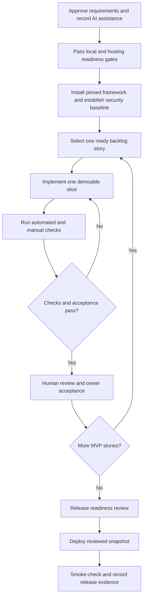

# Talas project and AI coding-agent workflow

**Status:** Working agreement for the Talas 2.0 course MVP. The project owner has directed that uncertainty about instructor rules will not block development; the owner remains responsible for applicable course disclosure requirements. The MVP scope baseline is owner-approved; detailed product rules remain open until decided. This workflow governs how coding agents help build Talas; it does not add AI features to the student-facing product.

## Project-specific settings

- **Default branch:** local `origin/main` is at `77034e4` as of the 2026-10-29 audit. PR #11 and PR #12 contain the later UI and navigation work. The owner confirms `main` requires pull requests and the PHP 8.2/8.4 CI checks and reports R-04 is all good. The accumulated local release branch has seven commits beyond `origin/main`; the exact app revision installed on InfinityFree remains unconfirmed. See [`docs/version-control.md`](version-control.md) for the actual checkout snapshot and procedure.
- **Runtime and dependencies:** PHP with CodeIgniter 4 and Shield, Composer, MySQL/MariaDB, server-rendered views, CSS, and plain JavaScript. Node/npm is approved only for development-time Playwright browser tests; it adds no frontend build or production runtime dependency. Keep it out of hosting uploads.
- **Required checks:** Follow `AGENTS.md`: relevant unit/feature tests, PHP syntax/style checks, dependency audit, manual browser check for changed interactions, and owner-isolation/direct-URL checks for auth, data-access, or deployment changes. Report checks individually and do not claim checks that did not run.
- **Database:** CodeIgniter migrations and safe synthetic seed data use local MySQL/MariaDB. Talas uses a separate loopback-only MariaDB instance because the original shared XAMPP data directory has a corrupt system table. The owner reports the hosted database import, hosted student registration/login, and manual hosted admin provisioning succeeded; application database connectivity is demonstrated. Remaining host checks are listed in `docs/deployment.md`.
- **Deployment:** InfinityFree free hosting via the target domain's assigned `htdocs` directory and FTP/FTPS. Do not assume SSH, server Composer, cron, remote MySQL, or a changeable document root. See `docs/deployment.md`.
- **Protected and generated files:** Never commit `.env`, credentials, student records, hosting details, or temporary probe content. `.tools/` is local and ignored. Manage `vendor/` and framework-managed files through Composer or official framework procedures; do not hand-edit generated dependencies.
- **Review and approval:** One implementer plus human review and project-owner acceptance. Sensitive changes may receive a second independent review only if requested. No merge or release without the required human decision.
- **Production smoke check:** The owner deployed the prepared package through InfinityFree File Manager and confirmed homepage/assets, student authentication, the aggregate admin dashboard, and the student-to-admin denial. The temporary hosting probe was removed. Review `docs/deployment.md` for remaining production checks and release evidence.

The repository automation inventory below was last refreshed on 2026-10-25; the branch snapshot was refreshed on 2026-10-29. Refresh these values when the Git setup, framework installation, or deployment target changes.

## Repository guidance, skills, and automation inventory

Keep instructions, available tools, and enforced checks distinct so nobody assumes a written rule is automatically enforced:

| Area | Current Talas state | Working rule |
| --- | --- | --- |
| Canonical agent guidance | `AGENTS.md`, linked to this workflow and the AI-use log. No `CLAUDE.md` compatibility pointer is present. | Keep one project-owned source of truth. Add a short tool-specific pointer only if that tool is adopted. |
| Project context and contracts | `README.md`, `docs/development-blueprint.md`, `docs/requirements.md`, and `docs/deployment.md`. | Use these as the product and deployment contract; record decisions in the relevant document. |
| Project-local skills | No `.agents/skills/` or `skills-lock.json` is present. The agent environment may provide general skills. | Apply an available skill only when its stated trigger matches the task. A skill is guidance, not a test or approval. Do not copy or pin skills into this repository without a concrete recurring need and an approved update/source process. |
| Framework guardrail manifests | No Flower or equivalent framework manifests are present. The official CI4/Shield starter is installed. | Keep project policy in reviewed repository instructions. Add machine-readable policy only when a selected tool can validate it and the rules have been reviewed for PHP, CodeIgniter, privacy, and hosting constraints. |
| CI | `.github/workflows/ci.yml` configures PHP 8.2/8.4, Composer validation and locked install, writable test directories, PHP syntax lint, PHPUnit, and `composer audit --locked`; `.github/dependabot.yml` schedules weekly Composer and Actions updates. Workflow permissions are read-only; third-party actions use full SHA pins. PR #7 first run passed with 67 tests and 612 assertions on each PHP version; the PHP 8.4 audit found no advisories. No PHP style tool or MySQL CI service is configured. | Keep checks aligned with `composer.lock`, the supported PHP range, and host runtime. Add database-backed CI only when an isolated synthetic test database and migration checks are ready. Do not add Node-only checks. |
| Git hooks | `.git/hooks/` contains Git sample hooks only; no `core.hooksPath`, Husky, or custom hooks are configured. | No hook setup is needed yet. If later adopted, keep hooks fast and local; CI and documented review remain authoritative. Do not make local hooks the only security gate. |
| Git collaboration | GitHub remote is configured; F-03 through F-10 are merged through PRs #1 to #5; restart/package work is in PR #9; CI and Dependabot in PR #7; PR #10 records package validation; PRs #11/#12 contain follow-up UI work. Local `origin/main` is `77034e4`. The owner confirms branch protection requires PRs and both PHP checks. | Use focused, owner-approved changes and reviewed pull requests. See [`docs/version-control.md`](version-control.md). |

This inventory was refreshed on 2026-10-25. Recheck the actual checkout before relying on it. Do not transfer RoomScouter-specific Next.js, Supabase, Flower, npm audit, or Husky decisions into Talas by analogy.

When `AGENTS.md`, this workflow, and a more specific approved story disagree, follow the more specific project instruction unless it would weaken a security, privacy, AI-use, or approval rule; in that case stop and ask the owner.

## Rules that govern AI use

CHED Memorandum Order No. 21, series of 2026 sets a higher-education framework for responsible AI use. It emphasizes human judgment, transparency, and protection of sensitive information while giving higher education institutions and faculty flexibility to set context-specific practices. This workflow records assistance accurately and keeps the student responsible for reviewing and understanding the work. See the [official CHED memorandum](https://cms-cdn.e.gov.ph/CHED/pdf/2026-CMO-21_AI-in-Higher-Education.pdf) and the [Philippine Information Agency overview](https://pia.gov.ph/news/luzon/ncr/ched-sets-guidelines-for-responsible-ai-use-in-higher-education).

The project applies these safeguards:

- The project owner has authorized transparent AI assistance for development. The owner remains responsible for checking and following applicable course requirements.
- Use AI to support the student's learning and work. The student remains responsible for requirements, design decisions, accepted changes, and the final submission.
- Disclose AI assistance in the form and place required by the instructor. [`docs/ai-use-log.md`](ai-use-log.md) supports that disclosure; it does not replace the instructor's required format.
- Review, run, and understand any AI-assisted code before accepting it. The student must be able to explain and demonstrate the result.
- Do not put passwords, hosting credentials, real student records, private course materials, or other sensitive information into a public AI service. Share sanitized examples instead.
- Never claim AI-generated or AI-edited work was produced without AI assistance. Do not use an AI detector as a substitute for explaining the work or following course policy.

## 1. End-to-end project flow



### Project gates

| Gate | Work | Exit criteria | Current state |
| --- | --- | --- | --- |
| G0: Scope and AI-use baseline | Review proposal, approve requirements, and settle product decisions before affected work. | Owner-approved `docs/requirements.md`; each MVP story has acceptance criteria and a requirement ID; material AI assistance is recorded. | MVP scope baseline approved by owner on 2026-10-13; some detailed behavior decisions remain open. |
| G1: Environment and hosting | Verify local PHP/tooling and the actual InfinityFree account using the temporary probe. | Compatible PHP/extensions, HTTPS, routing, database path, and private-path denials observed and recorded in `docs/deployment.md`. | Composer installed locally; PHP 8.2.12, mbstring and MySQLi available, `intl` loads with a CLI flag. On 2026-10-14, the owner reported host PHP 8.4.25, required extensions, HTTPS, static/direct PHP, rewrite route, probe private-path denials, and post-removal marker URL returning 404. On 2026-10-25, the owner reported current PHP 8.4.27 with `intl`, `mbstring`, `mysqli`, and `pdo_mysql` available; the temporary runtime diagnostic was deleted and returns 404. CI4 4.7.5 and Shield 1.4.1 are locked locally. The owner reports 15 hosted tables and nine migration rows; hosted registration/login now demonstrate database connectivity. The owner elected not to pursue the `/.env` `ERR_EMPTY_RESPONSE` further; the status is documented without classifying it as a 403/404. |
| G2: Secure foundation | Install official pinned CodeIgniter 4 and Shield; establish configuration, routes, session/CSRF defaults, deny rules, migrations and test setup. | Fresh local install works; secrets excluded; direct private-path and auth baseline checks pass. | CI4 4.7.5 and Shield 1.4.1 are installed and locked. Shield config uses student as the default group, disables magic links, remember-me, and last-active tracking, applies auth rate limiting, requires CSRF for unsafe requests, uses POST logout, and enables secure cookies/HTTPS in production. `/student` and `/admin` have session and server role boundaries; admin additionally requires `admin.access`; the pages expose no student data. Root deny rules are added. The isolated local database is configured and migrations are applied; local admin bootstrap and database-backed checks are complete. The owner reports hosted schema import, student authentication, and admin/student role-boundary checks passed; the owner elected not to pursue the `/.env` browser response further. |
| G3: Weekly vertical slices | Implement approved stories in backlog order, retaining a working demo at each week's end. | Slice acceptance criteria, security checks, docs and human acceptance complete before next slice is marked Done. | F-03 through F-13 are integrated on `main`; the F-11 through F-13 tree was included by PR #9 (merged 2026-10-25). Owner acceptance and historical verification evidence are in each story. This includes private check-ins and the aggregate admin dashboard. On 2026-10-25, the owner manually reviewed local student, admin, and guest experiences and reported all good; the public page was reviewed at desktop and phone-like widths with keyboard menu operation. The owner also reports the authenticated F-07 Plan journey review is complete with no current issue. R-07 is complete with the approved guest navigation and public Guide section. |
| G4: Release | Prepare and deploy the reviewed snapshot using the documented host process. | Deployment smoke checks pass, private paths are denied, release evidence and remaining host limitations are recorded. | The owner reports R-04 is all good after continuing release work. Earlier owner-reported checks included homepage/public asset, student auth, admin dashboard, student `/admin` denial, core study flows, plan time-cap enforcement, and check-in privacy. A package ZIP was built from current `main` at `4c02a39`; the exact revision now installed on the host was not independently confirmed in this session. The hosted `.htaccess` dotfile rule is present; the owner elected not to pursue the `/.env` `ERR_EMPTY_RESPONSE` further. |

The blueprint's four-week sequence guides story ordering. Security criteria apply to every gate and story; they are not postponed to the final hardening week. If a gate fails, stop dependent work, document the failure, and take the safest independent work that remains possible.

## 2. Roles and decision authority

| Role | Responsibility | Decision authority |
| --- | --- | --- |
| Project owner/student | Orders backlog, supplies/approves acceptance criteria, resolves product questions, records AI assistance, and accepts demo behavior. | Only role that approves scope and product behavior; responsible for the final submission and understanding. |
| Implementer agent | Inspects repo, proposes a small change, implements, checks, and records evidence. | May choose routine technical details within approved requirements; cannot invent behavior or expand scope. |
| Human reviewer | Reviews concrete diff, behavior, security/privacy, accessibility, and deployment impact. | Decides whether a change is safe to merge; owner retains acceptance and release authority. |
| Optional independent reviewer | Reviews a bounded auth, authorization, personal-data, or deployment change when requested. | Advises only; cannot approve, merge, or deploy. |

Use one implementer agent at a time. No standing swarm or parallel implementation. A second agent is an optional reviewer only when the project owner requests it.

## 3. Backlog states and transitions

Use a simple board with these states:

1. **Backlog:** Candidate work; not ready for implementation.
2. **Ready:** One story, acceptance criteria, requirement ID, and relevant security/privacy conditions are clear. Product decisions affecting behavior are recorded.
3. **Doing:** One implementer works on the story in a reviewable branch/change set. Scope changes return through owner decision and Ready.
4. **Verification:** Required automated checks and manual browser/security checks run; failures are fixed or documented as blockers.
5. **Review:** Human reviews the diff and evidence; sensitive changes may get optional independent review.
6. **Accepted:** Owner accepts the demonstrated behavior; all required checks pass and docs/traceability are updated.
7. **Deployed:** Reviewed snapshot is released and post-deploy smoke/security checks are recorded.

A story cannot skip states. A failed check returns it to Doing. Missing product behavior returns it to Ready after the owner decides. A failed deployment/security check blocks release.

## 4. Story readiness and intake

Each story must include:

- One user outcome, a requirement ID, and testable acceptance criteria.
- Relevant roles, owner scope, data sensitivity, and privacy constraints.
- A screen sketch or interaction notes when the UI flow is not obvious.
- The expected automated checks, manual checks, and any deployment implications.
- Any known course-specific disclosure requirements the owner wants applied.

The authentication foundation is tracked in [`docs/auth-foundation-story.md`](auth-foundation-story.md). Local Shield setup, first-admin bootstrap, migrations, database-backed auth review, and allowed/denied role flows are complete for the local milestone. The owner reports R-04 is all good, including hosted student authentication, hosted admin dashboard access, and the student/admin route boundary. The exact hosted revision and the `/.env` HTTP status remain unverified; see `docs/deployment.md`. Do not use local bootstrap against a hosted database.

### Task brief and repository inspection

Before editing, establish the brief: requested user outcome, observable acceptance criteria, boundaries, risk (data/security/auth/deployment/external users), and verification. Keep it short for a small clear task.

For every task, read applicable instructions and product docs, inspect the current branch and working tree, review relevant implementation/tests when present, and search related requirements/decisions. Do not discard, overwrite, or stage unrelated user changes. Summarize intended change, assumptions, likely files, risks, and checks. If behavior is unclear, ask the owner before changing it and continue only independent work while awaiting a decision.

### Branch, staging, and commit conventions

Use [`docs/version-control.md`](version-control.md) as the detailed procedure. In brief: preserve the current unborn `main` until the owner reviews the initial snapshot; once GitHub is connected, start each story from current `main`, work on a focused branch, stage only story files, inspect the complete staged diff, run required checks, and commit with a clear Conventional Commit message. The agent does not stage, commit, push, merge, or publish without explicit owner authorization. Never use destructive Git commands to resolve uncertainty.

Never claim AI-generated or AI-edited work was produced without AI assistance. Record material assistance and retained code in the project log.

## 5. Security procedure for every story

Before coding, classify the data and identify whether the story touches authentication, roles, student-owned records, optional check-ins, user input/output, files, external services, or deployment. Then apply the relevant controls:

- **Access:** Authenticate and authorize server-side on every route; scope every read/write and nested reference to the owner; deny by default.
- **Input/output:** Validate on the server, use framework CSRF/session facilities, parameterize database queries, and escape rendered data.
- **Privacy:** Minimize stored data; keep check-ins private; exclude them from admin totals and reports by default; never use real student records in development, prompts, logs, or CI.
- **Operations:** Keep secrets outside Git; protect non-public paths; use safe production errors; test direct URLs and cross-user access for relevant changes.
- **Dependencies/deployment:** Pin compatible dependencies, review audits, deploy only a reviewed snapshot, and record host behavior that is unverified.

If a control cannot be verified, label the story or release as blocked; do not present an assumption as a passing check.

Treat schema/migration, authentication/session, role/authorization, file/storage, secrets/configuration, deployment, and privacy-sensitive collection/display/retention/deletion as high-impact changes. Before changing them, inspect the current schema, migrations, constraints, and owner-scoping patterns; use a reviewed migration rather than editing a hosted database ad hoc; verify both permitted and denied paths with synthetic data in the approved local environment; ensure tests cannot target production; and document a recovery path for risky data changes. A successful app deployment does not prove a database change was applied safely.

For interface work, preserve semantic structure, labels, keyboard/focus behavior, contrast, and useful status messages. Check affected responsive layouts. Use existing project patterns and safe APIs; do not edit Composer-managed dependencies by hand. Update user-facing copy and operational documentation when behavior or limits change.

## 6. Per-story execution protocol

1. **Plan:** Confirm story readiness, inspect existing patterns, propose the smallest demoable change, and state assumptions.
2. **Implement:** Change only the approved story. Keep controllers thin, calculations in testable services, and use framework security facilities. No frontend framework or runtime build dependency without an explicit project decision.
3. **Verify:** Run the relevant unit/feature tests, PHP syntax/style checks, dependency audit, and manual browser checks required by `AGENTS.md`. Auth/data/deployment work also checks cross-user access and direct URLs to private paths where applicable. Do not claim a check passed if it was not run.
4. **Document:** Add an entry to [`docs/ai-use-log.md`](ai-use-log.md) for each task where LLM assistance materially contributed, following the instructor's rules. Record the tool/model, date, task, assistance type, retained suggestions or code, the student's changes, and verification. Summarize prompts; never copy sensitive material or full transcripts. Link changed behavior to requirement IDs; update traceability and deployment instructions when they change.
5. **Review:** Human reviews the diff and evidence. Sensitive changes may get an optional independent AI review when requested. Resolve findings. Owner accepts behavior; the human decides merge readiness.
6. **Release:** Deploy only after explicit release authorization, then run the documented smoke checks and record the deployed revision and results. Disclose AI assistance as the instructor requires.

For each check, report **Passed**, **Failed**, **Not run** (with reason), or **Not applicable** (with brief reason). Do not substitute a build for an authorization test, or a static accessibility check for review of the rendered interface. If visual behavior changed, inspect the page at relevant screen sizes; if data or authorization changed, check both allowed and denied access.

Before acceptance, inspect the final diff for scope, accidental secrets or personal data, generated files, and incomplete changes. Confirm acceptance criteria, check results, security/error paths, documentation, required human review, and intended merge target. Keep production data changes separate from application deployment.

## 7. Deployment procedure

Deploy only when the project owner or documented project procedure authorizes it.

Before deployment, confirm the reviewed revision, target environment and domain directory, required checks, pending migration/recovery plan, and production configuration without exposing secret values. Keep secrets and real student records out of the upload bundle. Upload the reviewed snapshot via FTP/FTPS and apply migrations only through the reviewed process in `docs/deployment.md`.

After deployment, confirm the intended revision is present, open the live application, run relevant smoke checks, check the affected route and primary journey, verify private-path denials, and inspect provider status/errors through approved tools. Record the deployed revision, target, live URL, checks, and limitations. If verification fails, follow the documented mitigation/recovery path and report what happened. A successful upload or a 200 response from the home page alone is not proof of a successful release.

## 8. Milestone workflow review

At weekly planning/review, use a short 0–3 rating for these risk areas: requirements/acceptance, isolated changes and diff review, automated checks, security/privacy and owner isolation, deployment/migration safety, and AI transparency. Use **0** for missing, **1** informal, **2** repeatable, and **3** enforced. Record evidence and address the highest-risk gaps; do not score every small story or optimize for a total. Production data exposure, unauthorized access, secrets, or unverified private-path denials remain blockers regardless of score.

## 9. Done criteria

A story is **Accepted** only when:

- All acceptance criteria pass and the owner has seen/accepted the behavior.
- The student has reviewed and understands the result and can explain and demonstrate it.
- AI assistance is recorded and disclosed in the instructor's required format.
- Required tests, syntax/style, audit, browser, and security checks pass or have a clearly recorded owner-approved exception.
- No known cross-user exposure, private-path exposure, secret leakage, or unresolved product decision remains in scope.
- Requirement traceability and deployment notes are current when behavior or controls changed.
- The review summary below is complete.

A release is **Deployed** only after the reviewed snapshot passes the release checks in `docs/deployment.md`. Report any account behavior that could not be verified.

## 10. Review record template

```text
Story / requirement ID:
What changed:
Owner decisions / assumptions:
Security and privacy impact:
Checks run and results:
Human review / owner acceptance:
AI assistance logged / disclosure status:
Unverified behavior or limitations:
Branch / commit:
Merge status:
Push / deployment status:
Target environment and live URL (if applicable):
Release revision and smoke checks (when deployed):
```

The final handoff should be self-contained and state what changed, why, files affected, checks run and their results, checks not run and why, manual review, branch/commit and merge status, deployment status, and remaining risks or owner decisions. Never imply that review, merge, push, or deployment occurred when it did not.
