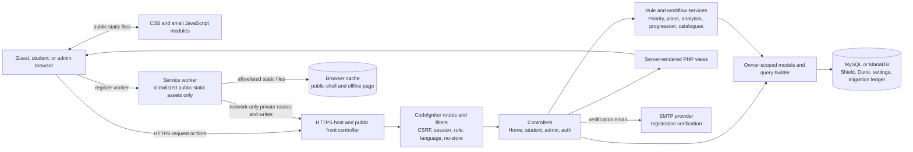

# Duno System Analysis and Design Packet

**Draft for the project paper**

**Prepared:** 31 October 2026

**Basis:** Owner-approved requirements F-01 through F-15 and S-01 through S-10 in [`requirements.md`](requirements.md), current CodeIgniter implementation, and local/owner-confirmed hosted migrations through `2026-10-30-000002_EnforceStudyPlanOwnership`. The owner confirmed hosted migration rows 17/batch 12 and 18/batch 13 on 2026-10-31.

> This is an implementation-grounded design draft, not a claim that every live-host acceptance check currently passes. On 2026-10-31 the owner reported that the live site is available and all pages were checked, superseding earlier provider-403 reports. The deployed revision and route-by-route evidence were not recorded. Historical feature and test evidence is cited where recorded; this audit did not run tests.

## 1. Project summary

Duno is a responsive web application that helps individual students organize subjects and topics, choose what to study, plan available study time, record completed sessions, and review descriptive study summaries. Students can optionally record private workload and energy ratings. Administrators see aggregate counts only.

The implementation uses CodeIgniter 4.7.5 and Shield 1.4.1, PHP-rendered views, CSS, small plain-JavaScript modules, and MySQL/MariaDB. The working app areas are Duno Focus, Duno Plan, Duno Timer, Duno Guide, and Aralytics. Priority, plans, progression, and summaries use documented deterministic rules. There is no generative AI, grade prediction, calendar integration, group study, native app, or background-worker requirement.

## 2. Requirements coverage audit

The owner-approved baseline is [`requirements.md`](requirements.md), including F-01 through F-15 and S-01 through S-10 and the accepted decisions linked there. The attached SRS is a draft for approval: its FR/NFR statements are reconstructed candidates, its objective statements are paraphrases, and its survey results are evidence rather than scope approval. The owner has since supplied the verbatim proposal objectives; they are reproduced and compared with implementation in [`DUNO_SRS_ALIGNMENT_DRAFT.md`](DUNO_SRS_ALIGNMENT_DRAFT.md). The detailed candidate-SRS crosswalk is in [`DUNO_SRS_TRACEABILITY.md`](DUNO_SRS_TRACEABILITY.md).

The table below reports source implementation against the approved repository baseline. **Implemented** describes a source capability with relevant historical test/evidence coverage; it does not mean that the live deployment has passed a fresh acceptance check. **Partially implemented** marks an approved requirement whose criteria or current review remain incomplete.

The procedural mapping from each approved requirement to a manual scenario, expected result, and evidence field is in the [acceptance verification plan](acceptance-verification-plan.md). Its cases are planned, not executed. Use the results table in that document to record the exact revision, environment, migration state, and evidence before upgrading any status claim.

| ID | Requirement | Current implementation | Status | Evidence status / caveat |
|---|---|---|---|
| F-01 | Public start page, student registration, numeric email verification, sign-in/out | Public Duno page; Shield session authentication; six-digit activation; resend/cancel, expiry, attempt and send limits | Implemented | Earlier auth and email checks are recorded; the owner reports the live site is available. A fresh auth/email acceptance run against the identified deployed revision remains unrecorded. |
| F-02 | Separate student/admin permissions | Explicit routes, session and exclusive-role filters; admin permission check | Implemented | Prior hosted student/admin route checks and feature tests are recorded; no current hosted route check. |
| F-03 | Student-owned subject CRUD | Owner-scoped subject model and form flows | Implemented | `StudentSubjectsTest` coverage is recorded; not rerun for this paper review. |
| F-04 | Topics with due date, importance, difficulty, progress | Topic management nested under the student's subject | Implemented in the current worktree | Difficulty migration 000001 was verified on the host at batch 12. Focused checks are recorded in the implementation update; they were not rerun for this paper review. |
| F-05 | Search and filters | Search across topic/subject title; subject, importance, progress and due-state filters | Implemented | Feature coverage is recorded in `StudentTopicsTest`; search terms use POST. |
| F-06 | Explainable topic priority | `TopicPriorityService` scores difficulty, importance, due date and progress; ties use due date, title and ID | Implemented in the current worktree | Formula and reasons are documented in `priority-story.md`; focused priority and plan-order tests are recorded in the implementation update and were not rerun for this paper review. Hosted difficulty column was confirmed at batch 12. |
| F-07 | Daily plan, edit/reorder/remove, mobile agenda | `DailyPlanService` builds blocks; `StudyPlanModel` persists owner/date plans and checks durations, ownership, scheduled-time conflicts; nullable item start times support the agenda | Partially implemented | Owner-confirmed hosted migration 16/batch 11 includes `start_time`; migration 000002 is now confirmed at batch 13 with three composite owner constraints. Current hosted plan flow and visual behavior remain unverified against an identified app revision. |
| F-08 | Timer, review then explicit save, edit/delete | Browser timer presents a review; server validates and saves whole-minute sessions only on explicit action | Implemented | Feature tests and earlier hosted workflow evidence are documented; no current live smoke check. |
| F-09 | Aralytics and printable study report | `AralyticsService` calculates period/session/subject/topic totals and activity series; private check-in patterns are shown separately and excluded from print | Implemented | Service and feature tests are recorded; fresh visual, chart-equivalence, and print checks remain outstanding. |
| F-10 | Curated study suggestions with verified program-outcome associations where available | Static, source-linked suggestions plus an owner-scoped outcome map | Implemented in current worktree for verified NVSU-linked BSCS/BSIS/BSIT programs | CHED program outcomes are shown; Duno suggestion links are editorial. Course-specific outcomes and unverified programs remain unmapped. |
| F-11 | Private optional workload/energy check-ins | Owner-scoped create/edit/delete and private summaries; no free-text note | Implemented | Feature coverage is recorded. Privacy is enforced in application queries/routes, not via native database RLS. |
| F-12 | Admin aggregate dashboard | Aggregate student/subject/topic/session/minutes counts; excludes admin identities and check-ins | Implemented | Admin feature checks and prior hosted role checks are documented; current hosted access is unverified. |
| F-13 | Responsive and accessible use, print, skippable/replayable guide | Responsive layouts and navigation, keyboard-oriented controls, print view, browser-only first-run guide | Partially implemented | Several visual/accessibility checks remain open. Owner reports the site is available; the exact route/device evidence and supported browser/viewport matrix are not recorded/approved. |
| F-14 | Saved-study XP, daily visit XP, streak and unlocks | XP from saved minutes plus once-daily visit awards; streak-day rows; deterministic level/unlock summaries | Implemented | Progression tests and migration evidence are recorded. Check-ins are excluded; current hosted behavior is not freshly verified. |
| F-15 | Installable PWA and selected public static offline shell | Manifest/icons, public-asset allowlist service worker, offline fallback, online/offline notice, package-root inclusion | Partially implemented | No schema change. Automated/browser/host verification remains pending; authenticated pages, records, and write requests are never cached or queued. |

### Alignment with the attached draft SRS

The supplied SRS v1.0 candidate statements are crosswalked to F-01 to F-15 and S-01 to S-10 in the aligned SRS. Repository requirements remain authoritative. The crosswalk records the proposal/survey conflict dispositions and the pending ISO/IEC 25010 evaluation.

The owner-approved proposal alignment now includes task difficulty in Focus/Plan and verified program-outcome associations in StudyGuide. These are implemented in the current worktree; the owner confirmed the difficulty and owner-integrity migrations on the hosted database on 2026-10-31. The timer, numeric workload/energy check-ins, Aralytics, search, print, accounts, and aggregate admin view are present in source. No ISO/IEC 25010 evaluation result or protocol is available. See the SRS alignment draft for the objective-by-objective comparison.

The supplied proposal and survey analysis are now available and incorporated in the aligned SRS. The earlier approved-requirement draft and raw survey responses have not been independently reconciled; numeric nonfunctional targets also remain open. Reminder preferences remain evidence only and do not approve implementation. The owner separately approved F-15 on 2026-10-30: installable PWA metadata and a public static offline shell. The worker excludes server-rendered pages, authenticated data, and write requests; no offline synchronization or queued changes are implemented. This adds no schema entities or migration. See [PWA story](pwa-story.md); browser and hosting verification remain pending.

### Additional approved supporting features

- NVSU program/course reference picker, CHED sample curriculum templates, and DepEd Strengthened SHS subject guides. Catalogues are code-defined and selected items are imported into the student's own subject list.
- English (default), Taglish, and Filipino language preference stored in the current browser.
- Username profile editing, mascot feedback cards, compact navigation, and onboarding enhancements.

These extend the subject and usability workflows; they do not change the core learning claims or introduce AI-generated recommendations.

### Cross-cutting security coverage

- Shield manages identities and session authentication; route filters authorize students and admins server-side.
- Student-owned reads and writes obtain the authenticated user ID and scope records in models/queries. MySQL/MariaDB has no PostgreSQL-style row-level security policy here; describe this as **application-enforced owner scoping**, strengthened by relational constraints.
- Forms use framework CSRF and server-side validation; output is escaped in views; model queries use the framework query builder/parameter binding.
- Check-ins are private to the student and excluded from admin aggregates and printable study reports.
- The app has security-header and no-store filters; the deployment package has deny rules for private code/configuration paths. Host verification remains a release risk because current headers and path-specific deny responses have not been recorded against the accessible live site.
- SMTP is used for registration verification. It is an external operational dependency; the rest of the app does not require external AI, calendar, or recommendation services.

### Security-requirement traceability

| ID | Control in the implementation | Audit status |
|---|---|---|
| S-01 | Shield authentication plus explicit session, role, and permission filters on protected routes | Code paths and focused feature checks are documented; owner reports live pages load, but no fresh role-boundary evidence is recorded. |
| S-02 | Owner IDs come from the authenticated session; owner-scoped models and composite foreign keys enforce ownership and subject/topic consistency | Session composite constraints are recorded as hosted. The new topic/plan-item migration adds database enforcement for those relationships but has not yet been applied to the host. No database-native RLS is configured. |
| S-03 | Framework validation, escaped PHP views, and query-builder/parameterized access | Feature tests and source review are recorded; not rerun in this audit. |
| S-04 | Global CSRF filter and framework session configuration | CSRF feature checks are documented; current HTTPS host behavior cannot be freshly checked. |
| S-05 | `.env`, local databases, and synthetic account material are excluded from the release | Repository/deployment workflow records this control; this audit did not run a new secrets scan. |
| S-06 | Apache deny rules and package rules protect application, configuration, vendor, and writable paths | Prior deployment checks exist; path-specific deny responses have not been freshly captured against the accessible live site. |
| S-07 | Check-ins are optional, owner-scoped, editable/deletable, and excluded from admin, search, and print | Focused privacy tests are documented; retention is student-controlled with no automatic expiry. |
| S-08 | Production environment disables debug output; framework production error handling is configured | Source/configuration is present; safe error output has not been freshly verified on the blocked host. |
| S-09 | Security headers and production database-debug settings are configured | Source/configuration is present; response headers and error rendering need a fresh deployed check. |
| S-10 | Dynamic responses receive no-store headers; static assets may use versioned caching | Filter/package configuration is present; response headers need a fresh deployed check. |

These rows distinguish an implemented control from a deployment acceptance result. For a paper defense, describe S-02 as application-enforced row-level access control, with the session relationships enforced by existing MariaDB composite constraints. Topic/plan-item composite constraints are pending hosted migration. The schema does not use native RLS policies.

## 3. System architecture

### Logical component view



### Layer responsibilities

| Layer | Responsibility |
|---|---|
| Browser | Presents responsive pages; submits standard forms; runs small interactions such as timer display, carousel, chart enhancement and browser-only preferences. It is not trusted to determine saved session duration or ownership. |
| HTTP/security edge | HTTPS, Apache rewrite/front controller, explicit routes, CSRF, Shield session, role/permission checks, language preference, registration throttling and response security/cache headers. |
| Controllers | Parse and validate request intent, obtain authenticated owner identity, call services/models, and select a view or redirect. |
| Services | Keep deterministic rules testable: topic priority, daily plan building, Aralytics summaries, check-in counts, progression thresholds, and static catalogue/import behavior. |
| Models/data access | Persist records, scope queries to the current owner, enforce relationship checks, and use transactions for multi-row plan updates. |
| Database | Stores authentication, student records, study history, private check-ins, streak awards, verification limits, and migration metadata. |
| SMTP | Sends the registration activation code. No background queue is assumed on free hosting. |

### Main request/data flow

1. A browser requests a route or submits a CSRF-protected form.
2. CodeIgniter routes the request through the configured filters. Protected actions require an authenticated session and the appropriate role.
3. The controller validates input and derives the owner ID from Shield's authenticated session, never from a submitted `user_id`.
4. A deterministic service calculates a priority order, plan block list, summary, or progression result when needed.
5. Owner-scoped model queries read or write MariaDB; database constraints protect key parent/child relationships and saved-history consistency.
6. The controller returns a rendered view or redirect with a short status message. Dynamic responses are marked non-cacheable.

## 4. Database design

### Logical entity relationship diagram

```mermaid
erDiagram
    USERS ||--o{ AUTH_IDENTITIES : authenticates
    USERS ||--o{ AUTH_GROUPS_USERS : assigned_role
    USERS ||--o{ SUBJECTS : owns
    SUBJECTS ||--o{ TOPICS : contains_owner_scoped
    USERS ||--o{ STUDY_PLANS : owns
    STUDY_PLANS ||--o{ STUDY_PLAN_ITEMS : contains_owner_scoped
    TOPICS o|--o{ STUDY_PLAN_ITEMS : optional_owner_scoped_source
    USERS ||--o{ STUDY_SESSIONS : records
    SUBJECTS ||--o{ STUDY_SESSIONS : classifies
    TOPICS o|--o{ STUDY_SESSIONS : optional_topic
    USERS ||--o{ CHECK_INS : records_privately
    USERS ||--o{ STUDENT_STREAK_DAYS : earns_daily_award
    USERS ||--o| REGISTRATION_VERIFICATION_LIMITS : has_limits

    USERS {
        int id PK
        varchar username UK
        tinyint active
        datetime created_at
    }
    SUBJECTS {
        int id PK
        int user_id FK
        varchar name
        varchar program_id "nullable code, no programs table"
    }
    TOPICS {
        int id PK
        int user_id FK "through owner-subject composite key"
        int subject_id FK "composite with user_id"
        varchar title
        date due_date "nullable"
        varchar importance
        varchar difficulty "low/medium/high; default medium"
        varchar progress
    }
    STUDY_PLANS {
        int id PK
        int user_id FK
        date plan_date
        smallint available_minutes
    }
    STUDY_PLAN_ITEMS {
        int id PK
        int user_id FK "composite with plan_id and topic_id"
        int plan_id FK "composite with user_id"
        int topic_id FK "nullable composite with user_id"
        varchar topic_title "snapshot"
        varchar subject_name "snapshot"
        smallint duration_minutes
        time start_time "nullable"
        smallint position
    }
    STUDY_SESSIONS {
        int id PK
        int user_id FK
        int subject_id FK
        int topic_id FK "nullable"
        smallint duration_minutes
        datetime completed_at
    }
    CHECK_INS {
        int id PK
        int user_id FK
        tinyint workload_rating
        tinyint energy_rating
        datetime recorded_at
    }
    STUDENT_STREAK_DAYS {
        int id PK
        int user_id FK
        date activity_date
        int streak_days
        smallint xp_awarded
    }
    REGISTRATION_VERIFICATION_LIMITS {
        int user_id PK_FK
        tinyint failed_attempts
        datetime last_sent_at
        tinyint sends_today
        date send_day
    }
```

`USERS` and `AUTH_*` are managed by CodeIgniter Shield. The identity table stores credential identities; the role assignment table stores the user's group (`student` or `admin`). Other Shield tables support login-attempt and remember-token behavior. CodeIgniter Settings owns its settings table, and CodeIgniter owns the `migrations` ledger. These framework tables are not duplicated as Duno domain entities.

The owner-aware relationships shown above were installed by migration `2026-10-30-000002_EnforceStudyPlanOwnership`, which the owner verified on the hosted database on 2026-10-31. `topics(user_id, subject_id)` references `subjects(user_id, id)`; each plan item's `user_id` must match its parent plan; and a non-null topic reference must belong to the same owner. The migration backfilled owner IDs from existing parents before adding constraints. Topic deletion first clears only the live reference on plan items, retaining their title and subject snapshots. The diagram now reflects the owner-confirmed schema; the deployed app revision and runtime relationship checks remain to be verified.

### Duno table dictionary

| Table | Important fields and keys | Purpose / integrity rules |
|---|---|---|
| `subjects` | `id` PK; `user_id` FK to `users.id`; `name` up to 120 characters; nullable `program_id` up to 80 characters; timestamps; index `(user_id,name)` | Student subject/course list. User deletion cascades. `program_id` is a catalogue code, not a foreign key. A selected course title becomes a student-owned subject row. |
| `topics` | `id` PK; `subject_id` FK to `subjects.id`; `title` up to 120; nullable `due_date`; `importance`; `difficulty`; `progress`; timestamps; index `(subject_id,due_date)` | Work items under a subject. Importance and difficulty accept low/medium/high; difficulty defaults to medium. Deleting a subject with topics is blocked; deleting topics with saved history is blocked. |
| `study_plans` | `id` PK; `user_id` FK; `plan_date`; `available_minutes`; unique `(user_id,plan_date)`; timestamps | At most one saved plan per student and local date. |
| `study_plan_items` | `id` PK; `plan_id` FK; nullable `topic_id` FK; topic/subject name snapshots; `duration_minutes`; nullable `start_time`; `position`; unique `(plan_id,topic_id)` | Ordered plan blocks. Deleting a topic nulls its reference while retaining the snapshot. Plan deletion cascades. Scheduled blocks are validated for daily cap and overlap in application logic. |
| `study_sessions` | `id` PK; `user_id`, `subject_id`, nullable `topic_id`; `duration_minutes`; `completed_at`; timestamps; index `(user_id,completed_at)` | Explicitly saved study history. Composite foreign keys ensure the selected subject belongs to the same user and optional topic belongs to that same subject. Subject/topic deletes are restricted when history references them. |
| `check_ins` | `id` PK; `user_id` FK; workload and energy ratings; `recorded_at`; timestamps; index `(user_id,recorded_at)` | Optional private student ratings. Application validation restricts ratings to 1 through 5; records are excluded from admin aggregates and print. |
| `student_streak_days` | `id` PK; `user_id` FK; `activity_date`; `streak_days`; `xp_awarded`; unique `(user_id,activity_date)` | One visit award per student/date and streak history. Study XP remains derived from saved session minutes rather than duplicated in a separate session-award ledger. |
| `registration_verification_limits` | `user_id` is both PK and FK; `failed_attempts`; `last_sent_at`; `sends_today`; `send_day`; timestamps | Per-account throttling state for activation-code attempts and sends. The activation identity/code and status remain in Shield-managed auth identity data. |

### Relationship and integrity notes

- All student-owned rows ultimately belong to a Shield user. The application derives the owner from the signed-in session and scopes each query; it does not accept ownership from form data.
- Session integrity is also database-enforced: `(user_id, subject_id)` references `(subjects.user_id, subjects.id)`, and `(topic_id, subject_id)` references `(topics.id, topics.subject_id)`. This prevents attaching another student's subject or an unrelated topic even if an application check regresses.
- Saved plan items keep `topic_title` and `subject_name` snapshots so a plan can still be read after a topic reference becomes null.
- Foreign-key actions preserve saved history: deleting users cascades their data; deleting plan headers cascades plan items; deleting topics can null plan-item links; topics/subjects used by saved study sessions are restricted from deletion.
- Important numeric and enumerated values are validated by the application. Do not claim SQL `CHECK` constraints for values that are only validated by CodeIgniter.
- Program/catalogue data is deliberately code-defined rather than normalized into `programs`, `institutions`, or `curricula` tables. The paper should describe this as an import/reference catalogue limitation, not as a relational university-curriculum subsystem.
- Priority scores, Aralytics totals, levels, unlocked views, and XP from study minutes are derived from source records. Daily visit XP is stored in `student_streak_days.xp_awarded` to enforce once-per-date rewards.

## 5. Low-fidelity wireframes

These text wireframes show page hierarchy and primary actions. They are design references, not screenshots of the deployed UI. The responsive interface uses a compact top bar and bottom navigation on mobile, and a wider top navigation on desktop/tablet.

### A. Public start and sign-in

```text
+------------------------------------+
| Duno logo             Language     |
| Mascot and short introduction     |
| Email address                      |
| Password                   [eye]   |
| [ Sign in ]                        |
| Create account | Verify account    |
+------------------------------------+
```

### B. Student home

```text
+------------------------------------+
| Duno       Focus Plan Timer More   |
| Welcome and current streak          |
| [Continue studying]                 |
| Today's priorities                  |
| Upcoming deadlines                  |
| Quick links: Focus / Plan / Guide   |
| Home Focus Plan Timer Guide Stats  |
+------------------------------------+
```

### C. Duno Focus

```text
+------------------------------------+
| Duno       Focus Plan Timer More   |
| Search topics and subjects          |
| Filters: subject, importance, state |
| Priority list with reasons          |
| Subject -> topics -> topic details  |
| Add subject / add topic              |
| Home Focus Plan Timer Guide Stats  |
+------------------------------------+
```

### D. Duno Plan

```text
+------------------------------------+
| Duno       Focus Plan Timer More   |
| Available study time [minutes]      |
| [Build or rebuild today's plan]     |
| Agenda blocks with start and length |
| [Move] [Edit] [Remove]              |
| Unplanned time and empty state      |
| Home Focus Plan Timer Guide Stats  |
+------------------------------------+
```

### E. Duno Timer and Guide

```text
+------------------------------------+
| Duno       Focus Plan Timer More   |
| Subject [select]  Topic [optional]  |
| Suggested preset: [25/5] [50/10]   |
| Timer display and start/pause       |
| Stop -> review -> explicitly save   |
| Guide: method, source, mapped outcome|
| Home Focus Plan Timer Guide Stats  |
+------------------------------------+
```

### F. Aralytics and administration

```text
+------------------------------------+
| Duno       Focus Plan Timer More   |
| Date range and searchable records   |
| Study minutes, sessions, completion |
| Charts plus accessible numeric data |
| [Print report]                     |
| Admin: aggregate counts only        |
| Home Focus Plan Timer Guide Stats  |
+------------------------------------+
```

### G. Public offline fallback

```text
+------------------------------------+
| Duno                               |
| You are offline                    |
| This public page is available.     |
| Sign-in, records, and saves need a |
| network connection.                |
| [Try again]                        |
+------------------------------------+
```

The service worker may cache only the manifest-listed public shell, offline page, and explicitly allowlisted static assets. It must not cache authenticated HTML, student records, form submissions, or API responses, and it does not queue writes for later synchronization.

## 6. Non-functional design summary

| Area | Design target |
|---|---|
| Platform | Responsive browser app; CodeIgniter 4; PHP 8.2+; MySQL/MariaDB; server-rendered HTML. |
| Security | Shield sessions and groups; CSRF; request throttling; server-side validation; output escaping; owner scoping; key composite foreign keys; private-path deny rules; secure response headers. |
| Privacy | Minimal optional ratings; student-only check-ins; no study records in admin drill-down, print reports, public URLs, or generated logs. |
| Explainability | Priority formula, daily-plan allocation, activity summaries, streak, and unlock rules are deterministic and documented. |
| Accessibility | Semantic labels, keyboard focus and actions, readable status messages, accessible rating/segmented controls, chart numeric alternative, print stylesheet, reduced-motion support. |
| Performance/operations | Small plain-JS assets; no required runtime bundler, queue, cron, or server Composer; production dependencies packaged locally for FTP deployment. The service worker caches only approved public static assets. |
| Localization | English default with Taglish and Filipino options; preference stored in current browser. |

## 7. Current gaps to close before paper submission or final demo

1. **Deployed revision:** The owner reports that the live site is available and all pages load. Migrations `2026-10-30-000001` and `2026-10-30-000002` are confirmed in the hosted ledger at batches 12 and 13; identify the deployed marker and confirm the running code matches the hosted schema.
2. **Deployed revision:** The owner has not identified the live revision/package marker in the latest availability report. Verify which package is live before treating the current worktree as the deployed implementation.
3. **Evidence separation:** Feature tests and some host flows passed in earlier recorded runs; this audit did not rerun them. Cite the specific story/test record and date. Do not claim that every requirement has been verified.
4. **PWA acceptance:** Installability, offline fallback, update behavior, and the static-asset cache allowlist still need browser verification on a reachable build. Private pages and writes must remain network-only.
5. **Runtime acceptance:** Run the approved Focus/Plan, owner-isolation, and topic relationship acceptance scenarios against the identified hosted revision; schema metadata alone does not prove request behavior.
6. **Paper evidence:** Capture sanitized migration metadata, stable application screenshots, and route-specific acceptance results. Keep the ISO/IEC 25010 evaluation marked pending until the protocol and participant/test data exist.
7. **Catalogue normalization:** Programs and curriculum catalogues are static application data and `subjects.program_id` is a nullable code. Add normalized institution/program/curriculum tables only if the paper's rubric requires the catalogue itself to be maintained relationally; the current approved product does not require that.
8. **Visual evidence:** Use current screenshots from a stable local or hosted build for paper figures. Text sketches here are low-fidelity wireframes and should be labeled as design wireframes, not screenshots of the deployed application.

## 8. Source basis

The functional matrix is traced to [`requirements.md`](requirements.md). Proposal and survey documents are treated as source evidence and do not override this approved baseline. The ERD is derived from the Duno migrations in `app/Database/Migrations`, Shield installed auth migration, and CodeIgniter Settings installed migration. The latest hosted ledger values below are historical owner-reported evidence, not a fresh database read. Architecture and page flows were checked against routes, controllers, services, models and views.

### Proposal-to-implementation delta (2026-10-30)

The owner approved difficulty-aware priority/planning and outcome-linked Guide content after the initial paper audit. The current source implements both: topic difficulty is Low/Medium/High with medium as the migration default; it contributes 1/2/3 points to Focus ranking, which Plan reuses. The Guide offers a subject selector scoped to the signed-in student's own NVSU-linked BSCS/BSIS/BSIT subjects and displays related program outcomes from [CHED CMO No. 25, s. 2015](https://legacy.ched.gov.ph/wp-content/uploads/2017/10/CMO-no.-25-s.-2015.pdf). The relationship between Duno's study suggestions and the official outcomes is an editorial association, not an official CHED recommendation; no course-specific outcomes are claimed. Other programs remain unmapped without verified outcome sources.

Focused tests passed: 31 tests and 355 assertions; relevant PHP lint and `git diff --check` passed. A coverage driver is unavailable. The owner later confirmed hosted migrations 000001 and 000002 on 2026-10-31; no matching code release or route-specific live acceptance was confirmed. See [traceability update](DUNO_SRS_TRACEABILITY.md#owner-approved-implementation-update-2026-10-30) and [deployment instructions](deployment.md#topic-difficulty-schema-update-applied-to-hosted-database-2026-10-31).

The proposal and survey source comparison is documented in [DUNO_SRS_ALIGNMENT_DRAFT.md](DUNO_SRS_ALIGNMENT_DRAFT.md#proposal-and-survey-conflicts-with-the-approved-baseline). Survey metrics remain descriptive and the ISO/IEC 25010 evaluation is pending.
